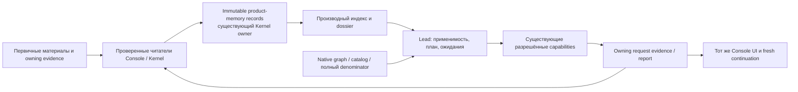

# Основа продуктовой памяти QA-agent — архитектурный дизайн

Дата: 2026-10-13. Автор архитектуры: actual Astra. Статус: точные решения для первой целостной реализации; подтверждение runtime/качества производится единым acceptance package, не этим документом. Пользователь выбрал выполнение программы; повторного пользовательского approval между её документацией и уже разрешённой реализацией не требуется. Новое внешнее действие за пределами полномочий задачи остаётся отдельным вопросом.

## 1. Цель, принятые основания и первая поставка

Память — основная способность продукта: QA-агент накапливает обоснованные знания о продукте, на новом запросе сам находит и проверяет применимые основания, выбирает содержательные проверки и сохраняет новые результаты. Человек не составляет JSON, не управляет индексом и не пересказывает прошлую переписку. Агент автономно предлагает и записывает знания в пределах разрешённого product owner; Kernel проверяет форму, идентичность, ссылки и запись, но не аттестует смысл утверждения.

Первая целостная поставка охватывает все восемь областей ниже: structured claims/conditional relations; typed primary references; историческую поддержку/применимость/конфликты; безопасную запись; ограниченный retrieval; старые notes; обычный owner/report/UI путь; единую ToolShop acceptance. Это конечный объём из трёх delivery blocks, а не обещание бесконечной серии пилотов. В scope входят 10 000 memory records, RU/EN literal aliases, несколько явно ассоциированных campaign owners одного продукта, v1-note coexistence и точные v4/v5 evidence readers там, где выбранный runtime их поддерживает. Не входят embeddings, Neo4j, новый LLM runtime, native graph expansion, автоматическое утверждение oracle, cross-product merge, изменение старых owner bytes, фоновые продуктовые действия или полная универсальность по продуктам.

Source carrier: normal clone `qa-agent-product-memory-foundation-20261013`, исходный root a81732955709ac32506c2defc20efd4e774f2786, manifest Console afed2bc74e4da5fce8b32c9b244b851fbb6ccd87 / Kernel 09300746bd7857e7a5973bd9d81065b746eb72d8. Изолированный K02 Console8463/Kernel2cf — донор отдельных принятых memory/v5 возможностей и локальных доказательств, не готовая замена нового main UI. Переносить старый Console целиком запрещено: принятую main функциональность и текущую host adoption сохраняем. Exact source map перечисляет применимые пути; существующие принятые capabilities не переоткрываются без затрагивающего изменения.

Указанный пользователем DocIR — `dj953590/docir`, inspected HEAD4f734274ac76b608d49347c6e328c4810f908805. Он остаётся reference-only: статический аудит не установил пригодной production foundation. Не использовать свойства другого `l0kifs/docir`, не импортировать код без установленного license/scope, не добавлять DocIR dependency.

## 2. Выбор архитектуры

| Вариант | Решение |
|---|---|
| Только prose notes | Сохранить совместимость и человеческую читаемость; недостаточно для проверяемой evidence chain, entity lookup и воспроизводимого применения условий. |
| Полное внедрение стороннего document/graph RAG | Не выбрано: не решает owning authority, runtime applicability и QA verdict; добавляет неподтверждённые зависимости. |
| Canonical memory в существующем Kernel-owner + derived retrieval | Выбрано: structured records и exact evidence refs; derived index/dossier; существующие report/coverage владельцы сохраняются. |



Память хранит знания и историю обоснования. Native graph/catalog/coverage хранит свои опубликованные mappings и охват. Request record хранит конкретную проверку и результат. Индекс хранит только ускоряющее представление. Ни один из этих уровней не дублирует authoritative verdict другого.

## 3. Идентичность продукта и срок жизни памяти

В main уже существует `profile.product.id`, но `contracts/recorded-intake.ts:115–117` выводит его из schemaVersion и slug. Одинаковый slug в независимых регистрациях поэтому не доказывает один продукт. Не переопределяем native product ID и не делаем глобальный join по нему.

В существующем memory owner вводится `agent-memory-product-binding.v1` в `.qa-private/memory/product-binding.v1.json`. При первой разрешённой инициализации Kernel сам выводит `memoryProductId = stableId('memory-product', {originOwnerId, nativeProductId})`, где originOwnerId получен из проверенной publication/workspace identity, а nativeProductId — из её profile. ID и origin остаются неизменными; текущий profile/authority digest хранится как binding, а не как identity продукта. Новый request, новый контекст recall, source revision и обновление читающего runtime не создают новый memoryProductId.

`memoryHome` — один существующий owner, канонически владеющий памятью данного продукта. Campaign owners владеют своими execution/report records и явно связываются с memoryHome. Это не новая служба или глобальный registry. Binding не меняет profile/graph/publication старого owner и не переносит его evidence. При первой инициализации legacy owner используется его существующий namespace; старые note IDs/bytes не меняются.

Ассоциация нового campaign owner создаётся существующим доверенным entry/registration workflow через точную операцию `associateAgentMemoryOwner`, а не на основании текстового slug/URL из заметки. Вход содержит выбранные source memoryHome и target campaign workspace, ожидаемые публично прочитанные authority identities и стабильный operation key. Host передаёт уже разрешённый product selection; новая ассоциация не требует повторного человеческого разрешения для каждого запроса. Kernel читает оба owning bindings, проверяет их равенство заявленным версиям и сохраняет immutable association receipt в единственном target campaign `.qa-private/memory/product-binding.v1.json` через expected-absent CAS. Инициализация memoryHome выполняется той же операцией self-association: оба workspace указывают один проверенный owner, оба expected authority digest равны текущему, target binding отсутствует; Kernel выводит identity и записывает home binding expected-absent. Для другого campaign memoryHome binding уже должен существовать и не переписывается. Readonly recall никогда не инициализирует binding: возвращает MEMORY_ASSOCIATION_REQUIRED с setup action. Два конкурирующих home association для одного target соревнуются за один target file; проигравший читает winner и возвращает conflict. Multi-root atomic transaction и глобальный registry не требуются. Если доверенного выбора same-product нет, возвращается `MEMORY_ASSOCIATION_REQUIRED`; агент может продолжить независимую QA без чужой памяти, но не делает предполагаемый merge.

Association фиксирует memoryProductId, source/target owner IDs, исходные native product IDs, роли `memory_home`/`campaign_evidence`, authority digests при принятии и разрешённый reference scope. Одинаковые slug/native product IDs сами по себе не дают association. Изменение authority требует reconciliation текущего association, не удаления истории; matching изменившегося digest не разрешается путём ручной перезаписи receipts. Ассоциация с другим уже связанным memoryProductId отвергается `MEMORY_PRODUCT_CONFLICT`. Rename продукта сохраняет memoryProductId при явном owning identity continuation. Смена memoryHome и слияние двух memoryProductId вне v1scope.

Новый campaign читает product-memory через memoryHome и исторические evidence через точный associated owner/format reader. Новый поддержанный runtime читает старые records по версии; неизвестная версия остаётся `unsupported`, не мигрируется молча. Если старый evidence owner недоступен, note остаётся читаемой историей с unavailable basis; новый PASS из неё не выводится. Cross-owner paths всегда разрешаются trusted routing, никогда строкой пути из body.

## 4. Модель знания: additive note.v2

Каноническая единица — immutable `agent-memory-note.v2` в существующей `.qa-private/memory/notes`. Сохраняются noteId/requestId/contentDigest/capturedContext/provenance и человекочитаемые title/body/limitations. Один record содержит один небольшой claim либо conditional relation; обычный шаг агента сохраняет 1–3 таких records. Операции записи независимы и возвращают отдельные receipts; частичный batch не выдаётся за atomic success. Не вводится giant ontology или универсальный business-rule language.

Дополнительные поля v2 draft:

- `memoryProductId`, полученный из verified context, не угаданный caller;
- `knowledge`: `epistemicKind` (`observation`, `expectation`, `hypothesis`, `unknown`, `operational`), `statement`, `subjects`, optional `relation`, `conditions`, `basis`, `limitations`;
- `concepts`: не более 8 новых локальных определений или ссылок на возвращённые concept IDs; `localId`, `label`, literal `aliases` и optional verified nativeTargetId;
- `links`: точные supporting/challenging/superseding/correcting record references с reason;
- `references`: union v1 references и новых typed source/request references.

Concept ID для нового локального определения создаёт Kernel из memoryProductId, note operation identity и localId; до ответа агент использует только local handles. Native target ID — cross-reference, не замена concept ID. Повторный recall позволяет переиспользовать возвращённый ID. Совпадение имени/alias не объединяет сущности. Обоснованное `same_entity` — отдельный агентский relation record с basis; альтернативные кандидаты остаются видимыми, автоматического переписывания чужих ссылок нет.

`relation` содержит `kind`, `from`, `to`, `meaning`, `conditions`, `basis`. Начальные kinds: `requires_state`, `represents_same_object`, `transitions_to`, `constrains`, `implementation_dependency`, `observed_association`, `same_entity`, `challenges`. Это семантика памяти, не новые ProductGraphV1 edges. Направление, условия и основания обязательны; relation лишь сохраняет сформулированное агентом утверждение. `implementation_dependency` не доказывает causal effect, `observed_association` не превращается в causation; неизвестная связь записывается hypothesis/unknown.

`conditions` имеет конечные axes: `environment`, `candidate`, `role`, `state`, `input`, `rule`. Для каждой оси обязательно состояние `known`, `unknown` или `not_restricted_declared`. Known условия используют exact scalar/список допустимых scalars и именованный product property/identity; допустимые mechanical comparisons только equality/set membership. Произвольный executable predicate, code string и выражения не исполняются. `not_restricted_declared` требует reason/basis и не аттестуется Kernel; отсутствующее условие нормализуется как unknown, не wildcard. Нормативная authority указываемого источника и применимость его версии сохраняются отдельно от observed support.

`basis` связывает конкретную часть statement/relation с exact reference и ролью `observed_support`, `expectation_source`, `counterevidence` или `inference_input`. Наличие receipt подтверждает bytes/identity, а не достаточность доказательства. Независимость двух источников не выводится из двух URL/копий; общий primary origin сохраняется. Повторное изложение наблюдаемого бага в собственном документе не может автоматически стать независимым expectation source.

Запись knowledge не означает publication, утверждение истины или native acceptance. `provenance=agent_authored_unattested`, authority=nonnormative остаются неизменными. Агент может самостоятельно сохранить supported correction/новую гипотезу; отдельный ручной semantic approval для каждой note не вводится. Native oracle/graph publication использует прежний owning route.

## 5. Typed references и receipt boundary

В v2 union добавляются:

1. `source_snapshot`: associated owner identity, existing source ID, exact source contentDigest, selected artifact/section locator, captured source version и immutable receipt identity. Source locator — данные, не команда. Целые bytes либо exact selection должны читаться через owning source reader; selection digest связывается с исходным digest и заданной областью. Удаление source из current publication не уничтожает историческое основание, если supported historical snapshot reader ещё возвращает exact bytes. Иначе `unavailable`, без подмены current URL.
2. `request_evidence`: associated owner ID; explicit recordFormat (`v4`/`v5`), request ID/revision, checkpoint revision+digest; selected observation/native evidence IDs либо execution/artifact IDs и returned content digests. Reference также содержит `contextPolicy=include_owning_qualifications`: reader возвращает относящиеся к выбранному evidence ограничения/исправления из доступной истории того же request и отмечает unread later revisions. Для v4 доступные evidence выбираются согласно его фактической grammar, а не придуманным v5 execution IDs.

`recordFileDigestAtRead` — provenance конкретного чтения, не постоянный ключ актуальности: последующий append cp4/cp5 изменяет cumulative file, не меняя cp3/artifact. Каждый read заново валидирует chain/membership и exact selected digests. Замена immutable checkpoint/execution/artifact при том же ID — integrity failure. Новое ограничение в позднем checkpoint не теряется из applicability; content старого primary остаётся историческим. Для K02 cp3 primary + cp5 GET-only conditions — обязательный контроль.

Kernel не импортирует Console и не доверяет wire-полю callerReceipt. В существующую trusted in-process runtime dependency добавляется один узкий `readRequestEvidence` resolver. Его реализация живёт в Console поверх существующего versioned request reader. `agent-memory-runtime.ts` собирает его из pinned source и передаёт Kernel; прямой Kernel caller без resolver получает `MEMORY_EVIDENCE_READER_UNAVAILABLE`, не verified. Resolver не предоставляется как пользовательский callback/динамический plugin URL. Он возвращает normalized selection receipt: exact owner/format/IDs/digests, provenance, capture conditions, membership/integrity, selected content и inspected/unread boundaries. Kernel проверяет контракт ответа, owner association, digests выбранных bytes и повторную стабильность привязки перед commit. Это тот же trust boundary выбранного Console/Kernel runtime, не криптографическая защита от владельца процесса с произвольным кодом.

Новый Console module `src/node/agent-memory-evidence-reader.ts` переиспользует current v4 reader и selectively adopted v5 reader; не дублирует их schema/chain validation. Agent-facing selection отдаёт metadata и selected primary/qualifications, а не весь report/старые планы. Missing exact selector не переключается на latest. Неподдержанный format возвращается явно. Внутренний reader вправе проверять полный record, но не обязан раскрывать его модели.

Для registered source detail требуется настоящий read-only путь без repair side effects; текущая память вызывает repair-capable registration reads. Реализация добавляет explicit no-repair policy в существующий owning read path, сохраняя прежний default для остальных callers. Никаких прямых managed filesystem обходов при отказе. Archived/external source, доступный лишь как local export, сначала должен иметь supported owning intake/receipt либо остаётся external/unverified; canonical duplicate evidence в memory не создаётся.

Receipt статусы различают `verified`, `unavailable`, `unsupported`, `integrity_failed`, `not_read`; binding исторический/current — отдельное поле. Нельзя свести их в один зелёный current. Save empirical claim с недоступным primary допустим только с явно записанным unresolved basis и без утверждения verified support; это unknown/hypothesis либо ограниченная observation с evidence gap. Попытка объявить verified basis без разрешённого reader отвергается.

## 6. Lifecycle, applicability и конфликты

Canonical records immutable. Исправление/retraction/supersession — новая note с exact target record ID+digest и reason; прежние bytes/эпистемическая история сохраняются. У версии knowledge есть identity и связь с предшественником, но нет mutable global truth bit. Два конкурентных successors остаются ветвями/conflict, последний timestamp не выбирает победителя.

В dossier/report сохраняется `agent-memory-applicability.v1`: exact task context digest; selected claim ID+digest; `historicalSupport` (verified_basis/unavailable_basis/contested/unknown); `currentUse` (applicable_declared/not_applicable_declared/suspect/unknown/conflicted); changed premises; conditional dependency path; reason; discriminating recheck; missing/unread remainder. Это агентское решение на контексте запроса, не переписанный canonical статус claim. Derived mechanical comparisons показывают same/different/unknown по finite conditions, но не выставляют semantic applicable самостоятельно.

При source scalar/type/rule/role/state/build изменении агент читает содержимое и оценивает claim dependencies. Source hash change сам по себе не означает semantic stale; неизменный hash при другом runtime/role не означает applicable. Противоречие требует сопоставимости subject/conditions/authority; разные роли или моменты могут быть совместимыми scoped claims. Агрегированный conflict index возвращает все зарегистрированные challenges/corrections, в том числе вне текущей search page; он не обещает обнаружить все противоречия естественного языка.

Очередь содержит changed premise → conditional dependency → possible impact → наблюдение, различающее объяснения. Healthy unchanged sibling сохраняет пригодность в своей области. Unknown build/removed rule/unmapped delta не сужают full request до известного neighbourhood. Старый PASS хранится как исторический результат owning request и не переносится на новый context. Independent expectations берутся из применимого source/контракта; memory validation не создаёт oracle.

## 7. Write/concurrency/idempotency/recovery

Публичные операции сохраняют знакомый короткий surface: `qa-memory recall`, `qa-memory read`, `qa-memory save`; обычному агенту достаточно recall → inspect selected evidence → save. Он составляет structured payload сам; UI может показывать понятную сводку записи. Product association/init и `qa-memory index rebuild` — owning setup/recovery операции, не ежедневная пользовательская работа.

Kernel exports: существующие `saveAgentMemory`, `recallAgentMemory` получают explicit versioned v2 input/result; новые `readAgentMemoryDetails`, `associateAgentMemoryOwner`, `rebuildAgentMemoryIndex`. Wire v1 не расширяется молча; dispatch по schemaVersion. Console CLI выбирает explicit `--format v2`; отсутствие flag сохраняет совместимое v1 поведение. Новый command handler не является runner.

Save v2 input: workspace/memoryHome trusted binding, opaque fresh context file, stable requestId, content-only v2 draft. Caller не поставляет вычисленные admission hashes, authoritative receipts, mutable file paths или verdict. Identity Kernel генерирует детерминированно из owner/product/request key. Existing operation с exact same input/context возвращает replayed=true даже после других записей; тот же key с иным намерением — `MEMORY_REQUEST_CONFLICT`. Для нового key stale authority — `MEMORY_CONTEXT_STALE`; она не превращается в silent recapture-and-write.

Используются existing atomic private write, symlink/hardlink/permissions guards, expected-target CAS и финальный readback. Глобального lock над native publication не вводим: чужие publication writers его не соблюдают. Используются existing per-target atomic-write/CAS guards и before/after authority/reference revalidation; они защищают запись конкретного memory record, а не обещают глобальную транзакцию со всеми источниками. Смена authority до commit даёт отказ; обнаруженная после возможного commit даёт historical/contextChanged либо WRITE_UNCONFIRMED согласно проверяемому исходу. Старый exact intent сохраняется. Busy/changed input возвращается recoverable refusal, не бесконечный retry. Crash-lock не снимается по одному PID/возрасту. Новый opt-in memory-only recovery использует exact writer instance и trusted termination witness (§15). Busy/unresolved — безопасный отказ, но не прохождение обязательного recovery acceptance; common supervised abrupt death должен восстановиться. Whole-host death без witness — явный предел доступности, не потеря/повторная запись знания. Независимые keys не теряются; конфликтующие corrections не перезаписываются. После неизвестного исхода агент сохраняет exact operation/input/context и выполняет read/retry того же key, не генерирует новый ID.

Successful result: resource ID, verified content+receipt, effect (`private_write`/`none`), replayed, captured/current context, indexState, unresolved refs и next allowed recovery. Index failure после успешного canonical commit не меняет outcome на unsaved: result сообщает saved + indexUnavailable. Readback failure после возможного commit — `MEMORY_WRITE_UNCONFIRMED`, а не safe retry with new key.

Конечные коды: existing MEMORY_* сохраняются; additions `MEMORY_ASSOCIATION_REQUIRED`, `MEMORY_PRODUCT_CONFLICT`, `MEMORY_FORMAT_UNSUPPORTED`, `MEMORY_EVIDENCE_READER_UNAVAILABLE`, `MEMORY_EVIDENCE_UNAVAILABLE`, `MEMORY_EVIDENCE_INTEGRITY_FAILED`, `MEMORY_INDEX_UNAVAILABLE`, `MEMORY_QUERY_BUDGET_EXCEEDED`. В ответе есть phase и finite recovery action; секреты, raw provider errors и пути чужих owners не раскрываются.

## 8. Bounded retrieval и derived index

Основной режим v2 использует точные product-local concept IDs, отдельно перечисленные literal aliases/terms, relation direction/kinds и ограниченный hop budget. Никакой неявной semantic search. Начальная нормализация `text.normalize("NFC").toLowerCase()`, version `literal-nfc-lowercase.v1` (не full Unicode casefold), без автоматического перевода/стемминга/склеивания RU/EN сущностей. Alias collisions возвращаются как ambiguous matches. Ranking детерминирован: exact ID, exact alias, literal token/substring; затем стабильный ID. Ranking не эквивалент confidence/authority.

Query v2: terms<=8 по256 Unicode chars; conceptIds<=16; relationKinds<=8; hops0..2; maxVisitedRecords<=1000; pageSize<=20; returnedEvidenceSelections<=8; output<=1MiB. Result: context+index generation; selected records/relations; path и reason matched; per-source evidence statuses; correction/conflict branches; native navigation/definitions/full denominator; counts/cursor; exact budget flags и uninspected remainder. `narrowingAllowed:false` сохраняется. Budget exhaustion не становится zero matches или full coverage.

Первый индекс без новых зависимостей — immutable JSON shards по record ID/normalized terms/aliases/adjacency и manifest generation. Canonical bytes остаются notes/associations. Index descriptors хранят record digests и provenance pointers, не вторую truth copy. Rebuild читает owning records постранично с ограниченной памятью, проверяет их schema/digests и строит новый generation в private temp, затем atomic publish. При error/crash старый generation не смешивается с новым; canonical records не меняются. Derived index можно удалить полностью и восстановить.

Сохранение note помечает прежний generation incomplete либо публикует новый bounded delta; correctness не зависит от успеха этого cache write. Reader проверяет version/memoryProduct/association/inventory binding и hashes выбранных records; stale index никогда не выдаёт отрицательный полный ответ. При отсутствии/порче индекса обычный reader выполняет bounded canonical fallback (<=1000records/16MiB на вызов) с opaque cursor и explicit incomplete, либо возвращает index-rebuild-required. Не запускает скрытый unbounded scan/repair. Rebuild — явная local cache operation без product calls. Авторитетный источник inventory — verified owning directory/records; индекс не может скрыть новую note. Before/after inventory signatures при scan гарантируют snapshot либо retry<=2 и затем conflict; cursor bound к generation/query/context, не reusable на другой query.

Измеряемый support target первой поставки: 10 000 canonical records общим размером<=160MiB, record<=16KiB, <=16refs/corrections, <=8concepts, <=1structuredclaim. Каноническая таблица benchmark находится в acceptance §7: rebuild<=60s, peakRSS<=512MiB; 32fixed queries×3orders; warm median<=2s/p95<=5s; cold process timings отдельно, без утверждения OS-disk-cache-cold. Index при query сохраняется. Transport hard limit output<=1MiB; 64KiB acceptance agent-context budget — отдельный мягкий бюджет отбора, не иной wire limit. Primary details учитываются отдельно и в общем agent budget. Больше support target — явный limit, не promise infinite scale. В benchmark отдельно публикуются filesystem/cache state, sizes, timings и FIRST failures. Generated copies проверяют масштаб IO, не семантическую независимость знаний. Выход за цель — repair or unsupported scale, не усреднение с маленькой базой.

## 9. Legacy notes и исторические owners

V1 bytes/IDs/readers сохраняются. Mixed inventory различает format; legacy note отображается как prose knowledge с unknown structured conditions/entities. Нельзя автоматически распарсить Domain claim и сохранить его как уже verified v2. Агент может создать v2 interpretation/adoption record с exact legacy note ref+digest, selected primary support и explicit inferred/unknown fields. Это новая прослеживаемая интерпретация, не миграция old fact.

Для явно associated historical owner read-only adoption link включает owner ID, note ID/digest и memoryProduct binding. Оригинальная note остаётся там, где была создана; canonical memoryHome хранит только link/новую интерпретацию. Пропавший historical owner становится unavailable, не вызывает filesystem bypass. При необходимости автономного сохранения материала используется supported existing evidence export/import с проверенными receipts; простое копирование managed trees запрещено. Такое detached import должно сохранять historical authority и не выдавать imported claim за новый observation.

## 10. Ordinary agent → owning result → UI → next request

Trusted entry выбирает product/memoryHome/campaign association и совместимый runtime, а не требует от пользователя внутренние пути. Agent получает компактный recall, открывает нужные primary, строит dossier и uses existing request definitions/assessments. Reasoning/remainingAction и typed claim/evidence references сохраняются в том же request report через whole-string versioned reasoning envelope (§16); при совпадающем native mapping связывается существующий ID, при отсутствии остаётся mappingLimitation и unassessed denominator. Native graph не расширяется ради записи памяти.

После owning readback агент сохраняет полезные knowledge records. UI читает версионированный owner view, показывает знания/источники/условия и текущее агентское решение, а не вычисляет альтернативный verdict. Для typed evidence есть exact primary navigation и отдельные historical/unknown/unverified labels. `verified bytes`, `agent-declared applicability`, `native result` не объединяются. Claim list не является activity log и не дублирует Claude host-activity adapter.

Main v4/export-v8 остаются поддержаны; из донора принимаются только необходимые v5/export-v9 modules/contract branches и affected UI projection. Same request key не конвертируется между форматами silently. Unsupported reader capability возвращает явный разрыв; нельзя выдавать экспорт v9 за читаемый main v8. Fresh continuation должен пройти через обычный documented entry и owner association, без K02 paths/старой переписки/готового DECISION. Актуальный A7 не ждёт этой поставки; изменения интегрируются с его принятым main интерфейсом после source resolution, без изменения его owner.

## 11. Три delivery blocks и единая приёмка

1. **Canonical knowledge и owning integrity.** Selective adoption memory prerequisites, product lifetime binding/association, v2records, typed refs и trusted request/source readers, immutable write/recovery/legacy coexistence. Affected source checks плюс negative authority/reference/concurrency controls. Не выпускать half-supported format под обычным entry.
2. **Retrieval и applicability.** Derived index/query/details, dossier/applicability/corrections и scale benchmark. Предварительно проверенная evidence format compatibility используется без изменения native verdict.
3. **Ordinary host/report/UI и полный acceptance campaign.** Main report/UI, fresh continuation, v4/v5 compatibility и существующие owner-output bindings; затем предварительно замороженные ToolShop-grounded cases, независимые actors/evaluator, actual permitted execution и memory continuation, сравнительные arms и recovery/scale results. То же независимое Astra AQA оценивает весь cohesive result; исправления проверяются affected controls тем же reviewer, а не новой полной церемонией.

Acceptance protocol — отдельный связанный документ одного пакета, а не инструкция для live запуска в этом design ходе. Его обязательные controls: cold producer без answer key; cold reader без исторической очереди; следующий request/associated campaign; реальные доступные deltas плюс clearly controlled stale source/scalar/type/removed basis/conflicting rule/role-state cases; healthy sibling+unknown/unmapped; irrelevant-but-valid evidence; circular oracle; wrongowner/same-slug collision; after-append cp3primary+cp5conditions; alias ambiguity/RUEN; sameintent/differentintent duplicate; competing writes; index loss/corruption/crash/rebuild; oldv1+newv2 coexistence; missing reader capability; main UI same-facts.

Структурный уровень проверяет contracts, exact identities/bytes, reads/writes/receipt recovery и denominator. Семантический evaluator заранее держит скрытую от actors reference: значимые связи, обязательные проверки, counterexamples и допустимые unknowns. Форма JSON/typed edge не доказывает знание; один case не доказывает устойчивость. Positive/negative samples сохраняются FIRST, отвергнутые exact inputs не заменяются без архива.

Выбранный первый full package обязателен в составе ONEproducer + S/R/L×2fresh stages (6consumer slots); L-недоступность оставляет comparative exit BLOCKED, а не молча сокращает full acceptance. Для последующих affected repairs допустим узкий S continuation без переименования его в полный пакет. Сравнительные arms получают одинаковые proposition/scopes/provenance/limitations и raw primary, модель/доступы/бюджет; literal-notes arm меняет представление, а не доступ к фактам. No-memory arm не лишается фактов producer и не получает скрыто меньше информации. Изменения второй стадии зеркально доступны всем arms. Outcome quality, critical omissions, unsupported oracle/PASS, applicability errors, retrieval cost и end-to-end costs считаются отдельно. Нет aggregate score, скрывающего safety failure. Заявление об ускорении/улучшении требует результата сравнения; структурная correctness не требует доказанной экономии.

Fair ToolShop acceptance не означает whole-product PASS: independent evaluator учитывает весь исходный request scope и неизвестность. Контролируемые варианты не объявляются deployed. Если реальный delta/build/role capability недоступны, соответствующий live exit остаётся open, а controlled result отдельно доказан. Успешная программа сохраняет точные boundaries, а не обещает заранее устранить runtime unknowns.

## 12. Конкретные файлы и критерий готовности

Kernel: selective adoption существующих agent-memory contracts/context/notes; новые `src/kernel/agent-memory-product.ts` (binding+association), `src/kernel/agent-memory-index.ts` (derived generation/query), `src/kernel/agent-memory-details.ts` (bounded exact refs), additions в `src/contracts/agent-memory.ts`; trusted resolver dependency type рядом с существующим memory runtime dependencies, не generic adapter registry. Existing registration source reader получает explicit no-repair option в своём owning module.

Console: существующие `scripts/qa-memory.ts`, `src/node/agent-memory-runtime.ts`; новый `src/node/agent-memory-evidence-reader.ts`; affected request report/outcomes/versioned export modules и текущий main UI consumer. Source skill/references описывают один ordinary flow, actual capability discovery и recovery. Exact UI filenames берутся из SOURCE-MAP текущего main, не из старого donor tree. Contract/module tests используют existing test harness; новый runner не создаётся.

Readiness первой поставки: agreed contract реализован в трёх blocks, все mandatory structural и semantic safety controls пройдены, ordinary host→owner→UI→fresh continuation доказан, index benchmark и limits опубликованы, failed/blocked/unassessed exits видны. Acceptance не может быть заменён красивой graph visualisation, количеством сохранённых notes или schema PASS. Неизвестный смысл честно сохранённого claim — допустимое знание; недоказанное объявление его истиной — дефект.


## 13. Права, недоверенные материалы и копии workspace

Memory access — capability выбранного trusted host/owner runtime, не поле draft. `save` требует разрешённый existing memoryHome write root; обычный readonly host может recall/read без owner/cache writes и должен честно вернуть read_only/not_saved при попытке save. После легитимной association ordinary owner-output entry включает memoryHome в разрешённый список write roots, если текущая action authority это допускает; произвольный wire path не расширяет список. Evidence origins/path hints разрешаются trusted owner routing. Литерал пути в source/body не выполняется и не используется как filesystem fallback.

Source instructions, aliases, документы и report content — недоверенные данные. Они не могут включать инструменты, менять permissions/schema, подменять owner, назначать authoritative truth или отключать unknown remainder. UI экранирует labels/body/links; alias retrieval ищет данные, не выполняет содержимое. Проверяем injection через label/alias и вложенный документ. Full Unicode casefold не заявляется: ß/SS различны без явного alias, ё/е не объединяются, Greek/case edge cases сохраняют точную выбранную normalization version.

Copied workspace с тем же product-binding не считается действующим memoryHome: current trusted realpath/publication owner binding должен совпасть, иначе IDENTITY_MISMATCH/association required. Новый clone не создаёт молча новый product и не получает права на исходный; перенос/memoryHome migration вне scope. Две независимые регистрации одинакового slug имеют разные originOwnerId; явная association необходима даже при равном nativeProductId. Runtime source upgrade не меняет memoryProductId, если approved owner binding и поддержанный historical reader остаются валидными.

Контекстные ограничения поздней owning history не могут быть доказаны одним old artifact. Resolver возвращает bounded later-checkpoint inventory и mechanically linked limitations; агент читает точные qualification artifacts и сохраняет их как `qualificationRefs`. Если в legacy record связь условий с primary только prose, resolver не выдумывает её: выставляет qualificationCompleteness=unknown и возвращает кандидаты/непрочитанный остаток. Агент может открыть нужный exact artifact (cp5 execution21 в K02), решить применимость и добавить verified reference; исходный cp3 не перезаписывается. Unsupported/unread qualification не даёт blanket applicable.

## 14. Нормативный interface appendix

Это проектируемый wire/runtime contract, а не утверждение наличия функций в текущем source. Типы существующих v1 references/author/context/receipts импортируются из их owning schemas; неизвестные поля отвергаются. Все ID/digest/cursor поля валидируются существующими строгими grammars. Сокращения `Id`, `Digest`, `OperationKey` ниже обозначают соответствующие существующие типы, а не произвольные strings. JSON scalars конечные, числа finite. Заданные ограничения из §§4–8 применяются schemas; optional означает отсутствие, не null как wildcard.

```ts
type Scalar = string | number | boolean | null;
type KnowledgeKind = 'observation'|'expectation'|'hypothesis'|'unknown'|'operational';
type ConditionAxis = 'environment'|'candidate'|'role'|'state'|'input'|'rule';
type Condition =
 | {axis:ConditionAxis; state:'unknown'; reason:string}
 | {axis:ConditionAxis; state:'not_restricted_declared'; reason:string; basisRefIds:string[]}
 | {axis:ConditionAxis; state:'known'; property:string;
    comparator:'eq'|'one_of'; values:Scalar[]; basisRefIds:string[]};
// eq требует ровно1 value; one_of 1..16 unique values; каждая axis присутствует.
type ConceptRef = {kind:'existing'; conceptId:Id}|{kind:'local'; localId:string};
type ConceptDeclaration = {localId:string; label:string; aliases:string[]; nativeTargetId?:Id};
type Relation = {kind:'requires_state'|'represents_same_object'|'transitions_to'|'constrains'|
 'implementation_dependency'|'observed_association'|'same_entity'|'challenges';
 from:ConceptRef; to:ConceptRef; meaning:string; conditions:Condition[]; basisRefIds:string[]};
type RefOwner = {ownerId:Id}; // path/runtime resolves only from trusted association
interface SourceSnapshotRef {type:'source_snapshot'; refId:string; owner:RefOwner;
 sourceId:Id; contentDigest:Digest;
 selection:{kind:'whole'}|{kind:'utf8_span';startByte:number;endByte:number;selectionDigest:Digest};}
interface RequestEvidenceRef {type:'request_evidence'; refId:string; owner:RefOwner;
 recordFormat:'v4'|'v5'; requestId:string; requestRevision:number;
 checkpointRevision:number; checkpointDigest:Digest;
 selection: {kind:'v5_execution';executionId:string;executionDigest:Digest;
   artifacts:{artifactId:string;contentDigest:Digest}[]}
  | {kind:'v4_observation';evidenceId:Id;contentDigest:Digest;manifestDigest:Digest};
 contextPolicy:'include_owning_qualifications';
 qualificationRefs:RequestEvidenceRef[]; // maxdepth1,total selectedrefs<=16, no cycle
 recordFileDigestAtRead?:Digest;}
// format v4 допускает только v4_observation; v5_execution только v5.
// native results v4 остаются existing observation/native reader refs; не имитируют embedded v5.
type MemoryReferenceV2 = {type:'legacy_reference';refId:string;reference:LegacyMemoryReference}
 | SourceSnapshotRef | RequestEvidenceRef;
// refId уникален в draft (1..64 literal chars), basisRefIds обязаны разрешаться.
// Wrapper существует только в v2; сохранённый v1 wire/bytes не меняется.
interface Knowledge {epistemicKind:KnowledgeKind; statement:string; subjects:ConceptRef[];
 relation?:Relation; conditions:Condition[];
 basis:{refId:string; supports:string; role:'observed_support'|'expectation_source'|
 'counterevidence'|'inference_input'}[]; limitations:string[];}
interface NoteDraftV2 {schemaVersion:'agent-memory-note-draft.v2'; requestId:OperationKey;
 memoryProductId:Id; title:string; body:string; author:LegacyAuthor; observedAt?:string;
 concepts:ConceptDeclaration[]; knowledge:Knowledge; references:MemoryReferenceV2[];
 links:{relation:'supports'|'challenges'|'corrects'|'supersedes'|'retracts';
   noteId:Id;contentDigest:Digest;reason:string}[]; limitations:string[];}
interface ContextV2 {schemaVersion:'agent-memory-context.v2';memoryProductId:Id;
 memoryHomeOwnerId:Id;requestOwnerId:Id;homePublicationAuthorityDigest:Digest;
 requestPublicationAuthorityDigest:Digest;homeWorkspaceDigest:Digest;
 requestWorkspaceDigest:Digest;associationDigest:Digest;builderVersion:'agent-memory-io.v2';}
interface SaveInputV2 {schemaVersion:'agent-memory-save-input.v2';workspacePath:string;
 context:ContextV2;draft:NoteDraftV2;}
interface NoteV2 {schemaVersion:'agent-memory-note.v2';noteId:Id;requestId:OperationKey;
 memoryProductId:Id;draft:NoteDraftV2;conceptIds:{localId:string;conceptId:Id}[];
 capturedContext:ContextV2;recordedAt:string;resolvedReferences:ReferenceResolution[];
 authority:'nonnormative';provenance:'agent_authored_unattested';contentDigest:Digest;}
type ReferenceResolution = {ref:MemoryReferenceV2;
 integrity:'verified'|'unavailable'|'unsupported'|'integrity_failed'|'not_read';
 binding:'current'|'historical'|'unknown';reason:string|null;
 receipt:SelectionReceipt|null;qualificationCompleteness:'complete'|'unknown'|'unread';
 unreadQualifications:number|null;};
interface SelectionReceipt {ownerId:Id;format:string;referenceDigest:Digest;
 selectedDigests:Digest[];recordFileDigestAtRead?:Digest;readAt:string;
 provenance:'agent_authored_unattested'|'native_verified'|'source_bytes';
 captureLimitations:string[];readerVersion:string;}
interface SaveResultV2 {schemaVersion:'agent-memory-save.v2';resource:{type:'note';id:Id};
 content:NoteV2;receipt:LegacyPrivateReceipt;effect:'private_write'|'none';replayed:boolean;
 contextChanged:boolean;capturedContext:ContextV2;currentContext:ContextV2;
 indexState:'current'|'incomplete'|'unavailable';unresolvedRefIds:string[];}
interface RecallInputV2 {schemaVersion:'agent-memory-recall-input.v2';workspacePath:string;
 query:{terms:string[];conceptIds:Id[];relationKinds:Relation['kind'][];hops:0|1|2;
 maxVisitedRecords:number;pageSize:number};cursor?:string;}
interface KnowledgeLinkIndexV2 {
 entries:{sourceNoteId:Id;sourceDigest:Digest;targetNoteId:Id;targetDigest:Digest;
 relation:'supports'|'challenges'|'corrects'|'supersedes'|'retracts';reason:string}[];
 branches:{targetNoteId:Id;successorNoteIds:Id[];disposition:'unresolved'}[];
 complete:boolean;uninspected:number|null;nextCursor:string|null;}
interface RecallResultV2 {schemaVersion:'agent-memory-recall.v2';context:ContextV2;
 narrowingAllowed:false;
 records:(NoteV2|LegacyNote)[];matches:{noteId:Id;reason:string;path:Id[]}[];
 links:KnowledgeLinkIndexV2;ambiguities:{term:string;conceptIds:Id[]}[];
 denominator:LegacyFullDenominator;navigation:LegacyNavigation;
 index:{state:'current'|'fallback'|'unavailable';generation:string|null};
 page:{lane:'records'|'links';total:number|null;matched:number|null;returned:number;nextCursor:string|null;
 complete:boolean;uninspected:number|null;budgetExhausted:boolean};}
interface DetailInputV2 {schemaVersion:'agent-memory-detail-input.v2';workspacePath:string;
 context:ContextV2;noteIds:Id[];references:MemoryReferenceV2[];}
interface DetailResultV2 {schemaVersion:'agent-memory-detail.v2';context:ContextV2;
 records:(NoteV2|LegacyNote)[];references:ReferenceResolution[];
 content:{refId:string;mediaType:string;digest:Digest;bytes:number;
 representation:{kind:'utf8';text:string}|{kind:'owning_binary';available:boolean}}[];
 unread:{refId:string;reason:string}[];}
// owning_binary bytes выбирает existing artifact reader/hostimage capability, не inlinebase64limit обход.
interface AssociateInputV1 {schemaVersion:'agent-memory-associate-input.v1';requestId:OperationKey;
 memoryHomeWorkspacePath:string;campaignWorkspacePath:string;
 expectedHomeAuthorityDigest:Digest;expectedCampaignAuthorityDigest:Digest;
 expectedAssociationDigest?:Digest;}
interface AssociateResultV1 {schemaVersion:'agent-memory-associate.v1';memoryProductId:Id;
 memoryHomeOwnerId:Id;campaignOwnerId:Id;associationDigest:Digest;
 effect:'private_write'|'none';replayed:boolean;receipt:LegacyPrivateReceipt;}
interface RebuildInputV1 {schemaVersion:'agent-memory-index-input.v1';workspacePath:string;
 context:ContextV2;expectedGeneration:string|null;}
interface RebuildResultV1 {schemaVersion:'agent-memory-index.v1';memoryProductId:Id;
 generation:string;canonicalInventoryDigest:Digest;recordCount:number;bytesRead:number;
 effect:'cache_write';elapsedMs:number;complete:boolean;}
```

`saveAgentMemory(input: SaveInputV2, deps?: WorkspaceKernelDependencies & MemoryRuntimeDependenciesV2): Promise<SaveResultV2>`; `recallAgentMemory(RecallInputV2,...): Promise<RecallResultV2>`; `readAgentMemoryDetails(DetailInputV2,...): Promise<DetailResultV2>`; `associateAgentMemoryOwner(AssociateInputV1,...): Promise<AssociateResultV1>`; `rebuildAgentMemoryIndex(RebuildInputV1,...): Promise<RebuildResultV1>`. V1 overloads сохраняются отдельно. Первый v2 context выдаётся только после self-association через AssociateInputV1 (§3); никакой hidden init в recall/save и нового daily human step. Cross-owner contexts содержат home и request digests отдельно; изменение любого требуемого binding делает новый write stale, но не стирает исторический record.

Trusted dependency `MemoryRuntimeDependenciesV2` определяется в новом Kernel `src/kernel/agent-memory-dependencies.ts`: `readRequestEvidence(ref:RequestEvidenceRef, access:VerifiedMemoryAccess): Promise<ResolvedRequestSelection>` и existing actor-authorized owner routing/access. `VerifiedMemoryAccess` не сериализуется и не принимается из wire: readonly/write capability, verified memoryHome/request owner bindings и allowed root set выдаёт существующий Console owner authority. `ResolvedRequestSelection` включает normalized `ReferenceResolution`, выбранные `{mediaType,bytes:Uint8Array,digest}` и qualification inventory digest/completeness. Непрозрачного readpoint token нет: перед commit Kernel повторно вызывает тот же trusted reader с тем же exact ref/access, сравнивает normalized owner/selection identities, выбранные bytes digests и qualification inventory digest/completeness. Изменение primary identity даёт integrity failure; новая qualification — contextChanged/refused new write до нового осознанного input. Current whole-file digest может измениться при безопасном append и учитывается отдельно. Resolver errors отображаются в конечные коды §7; отсутствие resolver не вызывает import/fs fallback. Доступ к record-format reader остаётся внутри Console, schema ownership не дублируется в Kernel.

Все results с большим/повреждённым payload имеют explicit unread/limit либо invalid outcome; не silent truncation. Evidence binary может быть содержательным доказательством при trusted bytes, object/context binding и image-capable reader; mediaType сам по себе не sufficient/insufficient verdict. Non-image host честно сохраняет not-inspected.

К `KnowledgeLinkIndexV2`: если все влияющие на выбранный claim links/branches не поместились, его conflict/qualification completeness остаётся unknown и возвращается отдельный link cursor. Entries из других search pages не скрываются за current-page filter; полный global scan не обещается при исчерпанном бюджете. Утверждение полного отсутствия corrections допустимо только на verified complete generation.

## 15. Конкретный recovery contract для обычного write path

Текущий `private-store.ts:308–329` хранит `qa-private-write.v1` с relativeTarget/expectedTarget/successorDigest; `:274–276` намеренно сохраняет неразрешённый admission. Поэтому handled exception не заменяет real abrupt-death контроль. Добавляется opt-in `qa-private-write.v2` только для новых memory writers; остальные callers/старые admission не меняются. V2 добавляет intentDigest, attemptId, writerSessionId, writerInstanceId, authenticated temp identity/basename и successorDigest. Это operational metadata того же private store, не дополнительный knowledge authority.

Обычный Console `qa-memory save --format v2` использует внутренний supervised file-writer child в `src/node/agent-memory-write-worker.ts`, собранный из того же pinned runtime; orchestration — `src/node/agent-memory-write-supervisor.ts`. Child выполняет одну owning memory operation, без browser/API/model/product actions. Он получает exact input через IPC и trusted runtime bindings; не arbitrary shell command/code. Parent сохраняет exact input digest и заранее выбранные cryptographically random session/instance/attempt IDs, наблюдает настоящий child exit/close через retained process handle. Kill request, PID existence/absence, timestamp/age и сообщение самого child не являются termination witness.

После observed exit/close parent записывает immutable `agent-memory-writer-termination.v1` в private operational area `.qa-private/memory/write-attempts/<attemptId>/termination.json`: exact instance/session/attempt, input/target/successor digest, exit kind и observation time. Путь и bytes строит trusted supervisor, не caller; write/read использует те же private guards. Эта запись разрешена только trusted Console supervision dependency, не обычной save draft. Capability ограничена связанным memoryHome. Persisted witness допускает отдельный следующий `qa-memory recover` при живом новом CLI процессе: trusted resolver читает именно managed receipt и сверяет instance/intent, а не принимает JSON witness снаружи. Это trust boundary доверенного runtime/private owner, не защита от злонамеренного владельца процесса, способного переписать source и managed files.

`recoverAgentMemoryWrite` требует исходный exact SaveInputV2 и attemptId из owning error/result, заново проверяет доступ и строго исходное намерение. Trusted `readWriterTermination` возвращает verified receipt либо unavailable; неизвестный/живой/иной instance, forged wire witness, разные intent/target/digest или неподдержанный v1 lock дают отказ. Recovery сначала получает exclusive per-attempt reconciliation admission в том же private-store layer, затем повторно читает исходный lock/target/temp с no-follow/inode/mode/root/parent checks. Конкурирующие reconcilers не могут снять новый lock после первого: recovery guard сериализует exact attempt, а lock instance повторно сверяется под ним. Guard не даёт глобальной publication authority.

Если target уже exact committed bytes исходного intent, owning readback возвращает тот же resource и original receipt semantics; удалять/перезаписывать его нельзя. Если target absent и exact dead admission/temp совпадают, recovery удаляет только проверенные operational artifacts/свой admission, фиксирует reconciliation и повторяет исходную запись с новым attempt token, но тем же operation key/input/context. Изменившийся authority/ref оставляет новый write stale; исторический committed record читается отдельно. Occupied different target или unknown commit не очищается. Операция recovery не повторяет продуктовые действия. Unexpected death самого recovery guard или supervisor до durable termination witness оставляет `MEMORY_RECOVERY_UNAVAILABLE`; blind force unlock отсутствует.

Это минимальный supervised common-crash путь, а не новый QA runner. Direct Kernel caller без supervisor может выполнить обычную запись, но не заявляет crash-recovery capability. Whole-host death без завершённого trusted witness остаётся disclosed availability gap. Для готовности P06 обязан пройти настоящий abrupt kill writer после admission/before commit + exact retry; P07 — после commit/before acknowledgment. Live/stale/forged witness negatives должны отвергаться. Safe busy без восстановления означает safety preserved, recovery NOT_ACCEPTED. Supervisor spawn/IPC/private metadata overhead входит в измеряемую стоимость записи, не скрывается.

```ts
interface RecoverInputV1 {schemaVersion:'agent-memory-recover-input.v1';
 original:SaveInputV2;attemptId:string;}
interface RecoverResultV1 {schemaVersion:'agent-memory-recover.v1';
 attemptId:string;disposition:'reconciled_committed'|'retried_committed';result:SaveResultV2;}
// Public: recoverAgentMemoryWrite(input:RecoverInputV1,deps:WorkspaceKernelDependencies
// & MemoryRuntimeDependenciesV2):Promise<RecoverResultV1>.
// CLI: qa-memory recover --input <original-v2-input> --attempt-id <returned-id>.
// No --force, PID/age or caller-supplied termination receipt.
interface VerifiedWriterTermination {attemptId:string;writerSessionId:string;
 writerInstanceId:string;intentDigest:Digest;targetRelativePath:string;
 successorDigest:Digest;preparedReceiptDigest:Digest;receiptDigest:Digest;observedAt:string;}
// Trusted in-process dependency only, same module as memory access dependencies:
// readWriterTermination(attemptId:string,access:VerifiedMemoryAccess)
//   :Promise<VerifiedWriterTermination|null>.
```

Recovery module Kernel `src/kernel/agent-memory-write-recovery.ts` uses narrowly extended existing private-store primitives; no exported raw unlink/clear-lock command. New errors `MEMORY_RECOVERY_UNAVAILABLE`, `MEMORY_RECOVERY_CONFLICT` follow existing QaError conventions with phase/recovery action. A public attempted write exposes attemptId only after its association with the exact intent is established; it never exposes a writable private path as authority.

## 16. Owning report payload и trusted access factory

Outer request/checkpoint v4/v5 и export v8/v9 strict grammars **не расширяются**. Для нового typed dossier поле `Assessment.reasoning` содержит целиком canonical JSON string envelope `qa-memory-assessment-reasoning.v1`, а не произвольный fenced фрагмент prose. Оно уже включено в owning checkpoint digest/export. Старое plain reasoning остаётся байтово читаемым. Envelope собирает agent/host helper, человек JSON не составляет. Не создаём sidecar knowledge/verdict store и не изображаем анализ продуктовым execution.

```ts
interface MemoryApplicabilityV1 {schemaVersion:'agent-memory-applicability.v1';
 taskContextDigest:Digest;memoryProductId:Id;
 claim:{noteId:Id;contentDigest:Digest;memoryHomeOwnerId:Id};
 historicalSupport:'verified_basis'|'unavailable_basis'|'contested'|'unknown';
 currentUse:'applicable_declared'|'not_applicable_declared'|'suspect'|'unknown'|'conflicted';
 references:MemoryReferenceV2[];
 changedPremises:{axis:ConditionAxis;property:string;reason:string}[];
 dependencyPath:{claimId:Id;contentDigest:Digest;
 basis:'direct_evidence'|'inference'|'unknown';reason:string}[];
 reason:string;recheck:string|null;limitations:string[];uninspectedRemainder:string[];}
interface MemoryAssessmentReasoningV1 {schemaVersion:'qa-memory-assessment-reasoning.v1';
 reasoning:string;applicability:MemoryApplicabilityV1[];}
// Console src/lib/agent-memory-report.ts:
// encodeMemoryAssessmentReasoning(value:MemoryAssessmentReasoningV1):string
// parseMemoryAssessmentReasoning(text:string):
//   {kind:'typed';value:MemoryAssessmentReasoningV1}|
//   {kind:'legacy';text:string}|{kind:'unsupported_or_invalid';text:string;reason:string}.
```

Limits: encoded string≤65,536 characters и все существующие UTF-8 whole-input budgets; applicability≤20, refs/path/remainder ограничены общим budget и transport limits. Encoder отказывает при превышении, не отрезает JSON. Exact strict parser признаёт только поддержанную schema; неизвестная version/повреждённый envelope остаётся исходным текстом с warning. Ordinary renderer показывает human reasoning + memory panel, не raw JSON; fallback всегда сохраняет исходный смысл/текст и unknown parsing. Shared parser используется CLI/main UI/export reopen для одной selected revision. Это agent-declared use; eligibility/outcome/native evidence/denominator остаются у прежних assessment/sufficiency contracts. Dereference только через owner access; ссылка внутри envelope не является полномочием.

Trusted access factory имеет один вход от ordinary Console runtime `src/node/agent-memory-runtime.ts`; implementation в Kernel `src/kernel/agent-memory-access.ts`. Host supplies registered owner routing + allowed roots/action mode, не wire draft. Прочитанный binding — identity evidence, но не разрешение произвольного path.

```ts
interface VerifiedOwnerBinding {ownerId:Id;workspacePath:string;
 publicationAuthorityDigest:Digest;workspaceDigest:Digest;}
// Opaque branded runtime object, constructor not exported as a wire API.
interface VerifiedMemoryAccess {readonly memoryProductId:Id;
 readonly memoryHome:VerifiedOwnerBinding;readonly requestOwner:VerifiedOwnerBinding;
 readonly associationDigest:Digest;readonly mode:'read'|'write';
 readonly allowedReadRoots:readonly string[];readonly allowedWriteRoots:readonly string[];}
interface TrustedMemoryHostAccess {
 mode:'read'|'write';allowedReadRoots:readonly string[];allowedWriteRoots:readonly string[];
 resolveAssociatedOwner(ownerId:Id):Promise<VerifiedOwnerBinding|null>;
}
// Kernel internal factory, not public tool/wire operation:
// resolveVerifiedMemoryAccess(workspacePath:string,host:TrustedMemoryHostAccess,
// deps:WorkspaceKernelDependencies):Promise<VerifiedMemoryAccess>.
```

Factory заново проверяет ordinary request owner publication, immutable product association, выбранный home и разрешённые roots через существующие guards; переданный ContextV2 сравнивается с результатом, не выдаёт права. `resolveAssociatedOwner` использует registered host routing/explicit setup bindings и проверенные receipts; unknown owner остаётся unavailable. Ни URL/path из body, ни copied binding не создают routing/permission. Для readonly пустой write-root set допустим; save/rebuild/recover требует нужный explicit write capability. MemoryHome write root добавляет ordinary entry при легитимном product selection и действующих write полномочиях; каждому новому request не нужен ручной approval.

Точный dependency member: `MemoryRuntimeDependenciesV2.memoryHostAccess?: Readonly<TrustedMemoryHostAccess>`. Он optional для сохранения v1/direct-reader compatibility, но все v2 операции требуют его: отсутствие возвращает `MEMORY_ASSOCIATION_REQUIRED` с phase `access` до чтения чужих owners/любой записи. Никакого fallback на caller roots/context. `readRequestEvidence?` и `readWriterTermination?` — optional readonly function properties с точными signatures §§14–15; отсутствие первого даёт unavailable для request refs, второго — recovery unavailable. Simple v2 source/legacy read не требует request resolver. Host access устанавливает только trusted runtime composition, не JSON wire.

Точный source routing seam: `TrustedMemoryHostAccess.resolveRegistrationSourceStore?(ownerId: Id): Promise<AgentMemorySourceStoreBinding | null>`, где `AgentMemorySourceStoreBinding = { readonly storeRoot: string; readonly sessionId: string }` (совместимая форма existing SourceStoreBinding). Optional capability: null/absence → source reference unavailable, не filesystem fallback. Kernel сверяет sessionId с заново проверенной owning publication выбранного ref.owner, проверяет registration-store root по trusted allowedReadRoots и использует existing registered reader с explicit noRepair. Same slug/session text из source не создаёт association. Store root никогда не приходит из v2 wire/body; callback устанавливается trusted Console entry из его registered mapping.

Для link pagination используется **тот же** `RecallInputV2.cursor`. Opaque cursor имеет внутренний tag `records` или `links`, привязан к exact query/context/product/index generation; link cursor дополнительно к исходному selected target-note ID+digest set (≤20). Он не caller authority и повторно валидируется. `RecallResultV2.page.lane: 'records'|'links'` — обязательный discriminator: на records page counts считают records; на links page counts считают scoped links. Link page возвращает records/matches пустыми, те же context/denominator и `KnowledgeLinkIndexV2` со следующей порцией; это не empty knowledge. Link entries≤query.pageSize≤20; чтения link/source/target records входят в единый maxVisitedRecords.

`KnowledgeLinkIndexV2.nextCursor` всегда tagged link cursor и передаётся в обычный recall без нового flag/операции. `page.nextCursor` продолжает текущую lane; на link page он совпадает с links.nextCursor. На records page record cursor и link cursor независимы: caller сохраняет оба при наличии. `links.complete` относится только ко всем incoming/outgoing applicability-changing links/branches выбранного target set, не ко всей памяти. При budget stop complete=false/uninspected count or unknown/nextCursor возвращаются даже если текущая порция пуста; affected claim conflict completeness unknown. Контроль target pageSize1,maxVisited2 +5 off-query links обязан получить непустой drainable cursor и завершить все5links через bounded calls; каждый continuation advances verified position либо явный stale/error, не бесконечно повторяет страницу. Отсутствие correction не утверждается до полного scoped drain на verified generation.

Точный derived-index root: `.qa-private/memory/index/` с generation subdirectories и manifest внутри этой области. Только эта область удаляется/портится в index-loss controls. Canonical notes, product-binding, operational write-attempts и evidence находятся вне неё и не затрагиваются. Path вычисляет Kernel, wire не задаёт output/cache root.

## 17. Append-only reconciliation и v4 exact bytes — уточнение реализации

`AssociateInputV1.expectedAssociationDigest?: Digest` — единственное добавление к операции association. Для genesis field отсутствует; для изменения ранее принятого authority binding оно обязательно и должно совпасть с **последним проверенным** associationDigest target campaign. Existing `product-binding.v1.json` — неизменяемый genesis/revision1. Новый `agent-memory-product-binding-revision.v1` хранится в `.qa-private/memory/product-binding-history/00000002.json` (fixed eight-digit decimal revision, далее последовательно) и содержит `{schemaVersion, revision, previousAssociationDigest, binding, associationDigest}`. `binding` — прежние identity/scope/current-authority поля без внутреннего associationDigest; новый digest охватывает весь envelope без собственного digest. Origin memoryProductId/originOwnerId/original nativeProductId/memoryHomeOwnerId/campaignOwnerId/role/referenceScope обязаны точно продолжать genesis; current home/campaign native IDs и authority/workspace digests могут изменяться только по заново проверенной owning identity continuation. Same slug или новый session/owner без доказанного owning continuation не достаточны. Identity continuity не выдаётся reader за факт одной строкой caller.

Kernel читает genesis и contiguous revision chain, проверяет strict schema/canonical bytes/digests/predecessor/identity на каждом шаге; authoritative selection — highest contiguous verified revision, не timestamp, filename glob maximum или mutable head pointer. Gap/duplicate/invalid/unexpected file не игнорируется и даёт invalid/conflict. Scope1 cap1024 total revisions, ≤16KiB per record; превышение — explicit unsupported limit, не unbounded scan. Before/after chain inventory+authority check обязателен. New reconciliation записывает ровно следующий numbered slot expected-absent CAS; два writers одного predecessor соревнуются за один slot. Exact same saved requestId/input returns same historical receipt/replayed; same key changed intent conflicts. Losing different intent возвращает association conflict, не silent rebase/append. Для прежнего current binding без изменений нормальный request использует recall context и вообще не вызывает association заново.

Home reconciliation выполняется self-association с current authority и expected selected home associationDigest. Campaign reconciliation затем отдельно фиксирует current home/campaign authority в своём owner с expected selected campaign digest; это не multi-root atomic transaction. Между ними старый campaign может быть stale для нового write и остаётся читаемым исторически. ContextV2.associationDigest — selected target campaign chain digest; home/request authority digests проверяются отдельно. Product identity не выводится заново из изменившегося profile/authority. Genesis и прошлые revisions/notes не переписываются, старый PASS не переносится. API result associationDigest/receipt указывает фактически выбранный committed revision; полная цепочка доступна owning read, но не обязана печататься агенту. Root access/allowed writes остаются прежними, новый global registry отсутствует.

Для v4 exact bytes уже существует допустимый публичный путь: Kernel `readAgentToolObservation({workspacePath,evidenceId})`, экспортированный через `src/index.ts`, возвращает `AgentToolObservationReadback.artifact: PrivateReadReceipt` с исходными bytes и manifest receipt. Он внутри owning API проверяет manifest membership, artifact digest/shape, historical/current binding и стабильность authority/bytes до возврата. Console **не** сериализует readback.payload и не читает managed artifact через raw filesystem/private-store fallback.

В existing pinned request runtime допускается узкий wrapper `readSelectedObservationBytes(workspacePath:string,evidenceId:string): Promise<{artifactBytes:Uint8Array;artifactDigest:Digest;artifactByteLength:number;manifestDigest:Digest;manifestByteLength:number;currentBinding:AgentToolObservationCurrentBinding}>`, построенный из public `readAgentToolObservation` того же pinned Kernel. Factory `createAgentMemoryEvidenceReader({resolveAssociatedOwner,createRuntime,now})` возвращает trusted dependency callback; `createRuntime` — существующая pinned runtime composition, не wire URL/plugin. Allowed roots/verified owner проверяются **до** обоих owning reads, source pin guard — до/после. `AgentToolObservationCurrentBinding` импортируется из existing owning public type, без дублирования shape в memory schema.

V4 resolver сначала проверяет exact selected checkpoint/evidence membership через public request reader, затем получает исходные bytes через wrapper и сравнивает evidence ID, artifact digest/byteLength и manifest digest/byteLength с checkpoint snapshot и ref. Mismatch — integrity_failed; exact typed bytes проверяются Kernel на returned digest ещё раз. Если runtime не экспортирует public byte-reader или observation больше недоступен, retained request metadata/payload может показываться как historical **metadata-only**, но `ReferenceResolution.integrity` для требуемого primary остаётся unavailable/unsupported, content[] пуст; verified selected bytes не заявляются. Текущий whole-file append не отменяет сравнение immutable selected checkpoint. V5 embedded UTF-8 продолжает существующий verified embedded-byte путь; он не используется для изготовления отсутствующих v4 bytes.

## 18. Trusted supervised-attempt seam и подтверждение до commit

В `MemoryRuntimeDependenciesV2` добавляется `readonly supervisedWriteAttempt?: Readonly<SupervisedMemoryWriteAttempt>`. Это trusted in-process composition Console worker, не поле SaveInput/draft/context, не wire receipt. Parent перед spawn создаёт UUIDv4 attempt/session/instance, сохраняет exact исходный input, вычисляет `intentDigest = digestCanonical(SaveInputV2Schema.parse(original))` тем же pinned Kernel canonical helper; normalization/version совпадает в parent/child. Child заново сверяет intentDigest до admission. Случайные operational IDs не входят в deterministic note/operation identity.

```ts
interface MemoryWriterIdentity {readonly attemptId:string;readonly writerSessionId:string;
 readonly writerInstanceId:string;readonly intentDigest:Digest;}
interface MemoryWriteAdmissionNotice extends MemoryWriterIdentity {
 readonly targetRelativePath:string;readonly successorDigest:Digest;}
interface MemoryWritePreparedAck {readonly attemptId:string;readonly preparedReceiptDigest:Digest;}
interface SupervisedMemoryWriteAttempt extends MemoryWriterIdentity {
 readonly onAdmissionReady:(notice:MemoryWriteAdmissionNotice)=>Promise<MemoryWritePreparedAck>;}
interface AcknowledgeMemoryWriteAttemptInput {readonly original:SaveInputV2;
 readonly writer:MemoryWriterIdentity;}
// Trusted owning composition export in agent-memory-write-recovery.ts, not a CLI/wire tool:
// acknowledgeAgentMemoryWriteAttempt(input:AcknowledgeMemoryWriteAttemptInput,
//   deps:WorkspaceKernelDependencies & MemoryRuntimeDependenciesV2)
//   :Promise<MemoryWritePreparedAck>.
```

Internal memory save передаёт identity и admission-ready hook в **один final canonical note** call existing private-store v2 opt-in. Не передавать hook глобально в все private writes: prepared/termination/cache/association operations не должны рекурсивно ждать own ACK. Private-store формирует relativeTarget, expectedTarget, successorDigest и temp identity из реально проверенных target/bytes, а не из parent hints. После durable admission+temp fsync, но до publication rename, вызывает hook и ждёт ACK. После ACK повторяет admission/parent/root/expected-target/source guards перед rename; ACK сам не даёт publication authority и не отменяет stale rejection.

`acknowledgeAgentMemoryWriteAttempt` выполняет узкую owning verification: independently resolves permitted memoryHome и deterministic target из original input, читает собственный admission через private-store guarded reader, проверяет UUID identity+intent, exact relative target/expected target, no-follow inode/mode/root/parent bindings, temp bytes/hash либо уже committed exact target. Target/successor из notice — лишь hint для сравнения, не полномочие. Исходные note draft/context/operation identity в staged/committed payload обязаны соответствовать original; caller-provided paths не принимаются. Только после этого операция сохраняет immutable `.qa-private/memory/write-attempts/<attemptId>/prepared.json` (`agent-memory-write-prepared.v1`) с verified identity/intent/target/successor/admission digest и receipt digest. Exact replay возвращает прежний receipt; mismatch конфликтует. Parent сравнивает результат с запомненным exact child instance/input и посылает ACK; child сверяет attemptId и prepared receipt through same owning state. Это operational receipt того же owner, не новый knowledge store.

Prepared receipt не является termination proof. Parent создаёт termination receipt только после действительного exit/close retained process handle **и** verified preparation; связывает его с preparedReceiptDigest и всеми existing writer/target/intent/successor полями. `VerifiedWriterTermination` получает обязательный `preparedReceiptDigest: Digest`; `readWriterTermination` проверяет обе managed записи и их совпадение. Если child умер после durable admission, но до ACK, parent может выполнить ту же owning verification после observed exit и затем записать оба receipts; это не доверие сообщению умершего child. Если частичный admission/temp невозможно проверить, recovery unavailable. Если parent умер до durable trusted termination, прежняя availability gap сохраняется. Отдельный новый CLI читает уже durable prepared+termination receipts через owning reader, не импортирует caller JSON.

Parent ACK и termination handling живут в existing Console supervision; никакой новый QA runner/daemon не нужен. Для обычного direct Kernel caller без `supervisedWriteAttempt` Kernel может создать собственные random attempt IDs для diagnostic v2 admission, но отмечает unsupervised и не имеет trusted preparation/termination capability; recovery unavailable, самостоятельное отсутствие PID не повышает права. Надёжность supervised common-crash проверяется actual P06/P07 SIGKILL, включая death до ACK, после ACK/before rename и after rename/before response; исходный fixed P06/P07 denominator сохраняется, это именованные точки того же контроля. Никакие source/product действия не повторяются ради recovery.

Prepared and termination metadata have a 16 KiB cap before allocation/decode, including rereads. Console uses the existing `memoryBoundedReadDependencies(deps, maxBytes, selected)` exported through the pinned Kernel index solely for trusted in-process dependency composition. Its fixed cap is `16384`; its predicate matches only the exact termination path derived from the verified memoryHome and validated attempt ID. Prepared reads use the same internal wrapper. Existing guarded `readPrivateFileVerified`, secret policy, root/identity and digest checks remain intact; no raw-handle export or caller JSON predicate, cap or path is added. An oversized witness is unavailable/refused, never a termination proof.

## 19. Native authority readpoint без квадратичного обхода памяти

В inspected candidate `agent-tool-observation.ts:432–438` selected reader пока вызывает полный `inspectRegistrationWorkspace`; оптимизированного existing selected-authority helper здесь нет. Сохраняем его owning validation semantics для native authority, выделяя узкий reader в `workspace-validator.ts`, а не объявляя старый full verifier быстрым. Full `inspectRegistrationWorkspace` остаётся неизменным внешним whole-workspace validation; memory operation не обязана повторно сертифицировать каждую постороннюю note/cache/evidence payload.

Новый **internal owning** seam: `createMemoryNativeAuthorityReader(deps:WorkspaceKernelDependencies): MemoryNativeAuthorityReader`, где `capture(workspacePath:string):Promise<MemoryNativeAuthoritySnapshot>` и `revalidate(snapshot:MemoryNativeAuthoritySnapshot):Promise<void>`. Snapshot opaque/branded, никогда wire/caller receipt; его scope=`memory-native-authority.v1`. Он содержит verified root binding, parsed publication/compilation, original owner/session identity, native workspace/publication digests, exact native byte inventory и file identities; он **не** `WorkspaceValidationReceipt.valid=true` для всего дерева. Existing memory context/access/nativeTarget mapping используют этот snapshot; no parallel source of product truth. Memory context digests сохраняют прежнее смысловое native binding, builderVersion отделяет новый reader.

Native closure определяется owning validator, не caller allowlist: publication; `.qa-managed.json`; все фиксированные registration private-state authority inputs (state, recorded intake/host-path inventory/workflow state и остальные реально участвующие поля existing validator); declared managed/native profile/graph/catalog/coverage/strategy/unresolved/versioned files; owning registration membership и необходимые native transaction/publication admission descriptors/journal authority. Exact files берутся из проверенных registry/publication/owning schema, paths дополнительно ограничиваются existing path policy. Новые/пропавшие native managed files, ownership overlays, active/uncertain native transaction и admission не скрываются: ограниченная native-directory/admission inventory проверяется на каждом readpoint; referenced authority journal bytes/chain валидируются по прежнему owning contract. Это refactor native validation closure, не разрешение выкинуть неудобную native prerequisite.

Рекурсивные `.qa-private/memory/notes`, `index`, `write-attempts` и независимые private evidence payloads **не входят в native closure**. Проверяется безопасная root/ancestor boundary, а выбранные memory records, product-binding chain, link/index inventory и evidence читаются своими owning readers с их budget/consistency/root/receipt guards. Unselected memory content не аттестуется и не влияет на native publication digest. Native admission check не должен принимать посторонний private-write lock за разрешение native publication; выбранный memory target admission всё равно проверяется private-store. Новый неизвестный native entry — diagnostic/refusal, не автоматически признанная memory область.

На каждом capture/revalidate реально читаются байты native closure через no-follow regular-file reader с exact modes/nlink/root/parent identity checks, вычисляются content digests и сравниваются file identities, размер и inventory. Stat/mtime/size/inode сами по себе не достаточны. Parsed schema/compiled projection разрешено переиспользовать **только** когда новый guarded byte read и native inventory полностью совпали с ранее проверенным snapshot, плюс совпали runtime/dependency identity, schema/generator/workflow/secret-policy identity и root binding. Вся native structural/cross-model validation выполняется на первом readpoint либо новом exact fingerprint; changed fingerprint инвалидирует prior snapshot/cache, а текущая операция возвращает authority/context changed, не молча принимает новое authority. Новое обычное обращение может получить свежий validated context.

Cache scoped к явно созданному reader instance в trusted runtime/operation/process; caller не передаёт cache entries/tokens. Нет глобального registry, persistent cached authority receipt, cross-runtime shared cache, FS watcher или таймера freshness. Предпочтительно один reader instance на процесс/пinned runtime, переиспользуемый home=request и вложенными access/native mapping/ACK/finalize вызовами; совпадение owner не требует двух независимых перекомпиляций. Между процессами bytes проверяются заново; parent не пересылает ребёнку cached authority как доказательство. Индекс и knowledge namespace имеют отдельный mutable inventory и не инвалидируют compiled native model от каждого нового note.

Перед commit повторяется revalidate native snapshot, association/current refs и конкретного target; после commit/readback повторяется readpoint. Readonly recall получает начальный/конечный native readpoint и свой индекс/record readpoint. Это обнаружение endpoint drift и owning admission по прежнему контракту, **не** глобальная транзакция с native publication и не утверждение невозможности мгновенного ABA между чтениями. При пост-commit drift возвращается truthful committed-historical/contextChanged либо uncertain согласно readback, а не unsaved. Новая native mutation не маскируется успешным memory append; одновременно добавленные независимые notes не меняют native authority и остаются subject to their own CAS/index remainder.

Mandatory affected negatives: (1) изменить bytes native graph/registry/publication тем же размером и восстановленным mtime — stale/invalid; (2) менять native profile/strategy/coverage между initial/precommit/final readpoints — отказ или truthful postcommit state, без актуального PASS; (3) symlink/hardlink/mode/root-dir/ancestor/inode replacement при прежних bytes — отказ; (4) competing native publication/active journal/admission — existing conflict сохранён; (5) registered source/evidence mutation остаётся обнаружимой отдельным ref reader; (6) concurrent different memory keys survive, same-key conflict preserved, new off-query correction не скрывается cache; (7) unrelated note/index growth не запускает native compile/recursive namespace walk, но corruption выбранной note/index не принимается. Instrumented filesystem call counts могут доказать отсутствие повторного memory traversal; это не замена actual elapsed/RSS benchmark.

Public save/recall benchmark использует реальные owning API и guarded IO. Генерация10k может повторно использовать один pinned in-process public API runtime; это явно фиксируется, а отдельная ordinary supervised write/recovery проверяется своим настоящим путём. Не заявлять скорость10k отдельных fresh CLI/spawn вызовов по in-process измерению; если claim относится к supervised path, spawn/IPC/receipt overhead включается. Existing scale30min slice, generation20min и warm2s/p95five targets не повышаются. Ускорение является проверяемой целью реализации; этот appendix не результат замера и не разрешение исключить guard cost из цифр.

## 20. Восстановимые физические попытки derived index

Logical generation остаётся digest(product identity, current canonical inventory signature, builder/normalizer version), независимо от физических попыток rebuild. `expectedGeneration:null` означает «начать на заново захваченном current canonical generation», **не** «кеша нет». Nonnull должен совпасть с текущим вычисленным logical generation; missing/corrupt index не меняет эту проверку, stale canonical generation даёт STALE_CURSOR/INDEX_STALE. Начальный и финальный inventory/context readpoints обязательны; публикация stale attempt не становится текущим индексом.

Физическая область: `.qa-private/memory/index/<full64hexLogicalGeneration>/attempts/<uuidv4>/`. Каждый rebuild создаёт fresh random attempt через exclusive directory admission; collision retry≤3, затем explicit limit/conflict. Все shards и final `manifest.json` принадлежат только этому attempt; deterministic shard relative names допустимы **внутри** attempt. Manifest записывается последним existing immutable expected-absent atomic write после guarded readback всех записанных shards и final canonical/context revalidation. Manifest — commit marker; нет mutable current.json, ремонта прежнего shard, общего selector lock или force unlock. Abandoned v1 lock старой попытки не мешает новому pathname.

Manifest содержит logical generation/product/inventory/builder/normalizer и deterministic semantic shard descriptor set/content root. Physical attempt UUID не входит в semantic content root; envelope может привязывать UUID отдельно. Тождественный canonical inventory должен давать одинаковые descriptors/semantic content root независимо от order/time/UUID. Reader вычисляет текущий logical path, делает bounded безопасный shallow inventory attempts, проверяет candidate manifest schema/canonical bytes/digest/path/product/generation/inventory/builder. Только complete manifest допускается к выбору; invalid/missing marker — unusable attempt, не пустая память. При нескольких пригодных manifests одинакового semantic root выбирается lexical UUID order, не timestamp/latest. Два structurally valid manifests с **разными semantic roots** для одного logical generation дают INDEX_UNAVAILABLE/conflict, не произвольного winner; новое повреждение не получает truth authority.

Ни manifest self-hash, ни наличие commit marker не заменяют existing shard/selected canonical record/correction checks. Используемые shards читаются через guarded exact-digest reader, selected records сверяются с canonical source. Corrupt candidate допускает bounded попытку другого committed candidate **с тем же semantic root**; уже собранный partial result первой попытки отбрасывается. Если usable equivalent candidate нет, возвращается accurately bounded canonical fallback либо index-unavailable/rebuild-required, никогда zero-complete. Отсутствие корректной correction/relationship по cache не заявляется вне existing completeness proof. Новый rebuild читает canonical records и создаёт новый attempt, не копирует повреждённый кеш. Concurrent same-inventory rebuilds могут оба завершиться; это два эквивалентных кеша, не два знания и не конфликт canonical saves.

Cursor дополняется `retrievalMode:'indexed'|'fallback'` и `indexContentDigest:Digest|null` при сохранении logical generation/query/context/lane/offset/targets binding. Он не закрепляет physical UUID. После repair continuation допустим только при совпадении deterministic semantic root и indexed mode; смена indexed↔fallback или semantic content root делает прежний cursor stale. Нельзя интерпретировать indexed offsets как canonical fallback offsets. Physical deletion/corruption одной попытки допускает equivalent-cache selection без потери/дублирования страниц. Result.index.generation и rebuild.generation продолжают означать logical generation; physical attempts — diagnostic cache metadata, не record count.

Bounds:≤32physical attempt directories в текущем logical generation; ≤32candidate manifests, каждый≤1MiB; известные shard/output/rebuild caps сохраняются. Discovery не рекурсивно читает все attempts/shards. Cap проверяется до нового attempt и на readpoint; concurrent пересечение лимита приводит к explicit INDEX_UNAVAILABLE/LIMIT_EXCEEDED, не скрытому усечению поиска. Total immediate logical generation dirs≤256 для создания нового generation; обычный recall открывает только current logical path и не сканирует старые generations. Orphan/temp/lock без complete marker никогда не становится selected; arbitrary symlink/special/foreign entry не следуется и даёт безопасный invalid/cache-unavailable.

Scope1 не вводит автоматический GC и не удаляет чужие/inflight attempts. При cap exhaustion память остаётся canonical-readable через bounded fallback с remainder; cache readiness не считается passed. Явное owning cache maintenance может очистить **только** ephemeral index область при доказанном отсутствии её активных writers, иначе unavailable; ручное снятие private-store locks вне index не разрешено. Возможность finite cap exhaustion раскрывается, не маскируется бесконечными nonce directories. P09/P10/P12 обязаны доказать: indexloss/corrupted shard/abandoned old attempt lock→fresh rebuild; crash до manifest→nonselected; crash после manifest→verified cache либо unavailable; equivalent concurrent rebuilds; stale expectation; cursor continuation через equivalent attempt; mismatch root/mode cursor refusal; cap refusal без canonical effect. Исходные FIRST failures не заменяются новым чистым trace.

## 21. S18: текущий image gap и минимальная допустимая граница

У текущих approved memory selectors нет exact binary image route: v4 agent observation artifact — JSON с пустыми attachments, v5 embedded artifacts — UTF-8 text/JSON, registration source intake не является PNG storage. Существующий native campaign layer действительно допускает `final.png` и проверяет его receipt digest/size (`console-campaign-v1.ts:180–188`); `campaign-receipts.mjs:1575–1591` проверяет PNG stream, но сохраняет в captured map только JSON/HTML, а public readLatestCampaignEvidence возвращает metadata/accounting. Host image tool сам по себе не создаёт owning reference. Следовательно S18 paired supported-image positive сейчас **NOT_IMPLEMENTED**, даже если negative refusal tests проходят.

Минимальный follow-up использует existing Console owning campaign reader: bounded `readSelectedCampaignArtifact` для exact run/check/attempt/final.png с expected receipt digest, existing stable read/admission/manifest validation и exact original binary bytes. Затем memory-only RequestEvidenceRef получает отдельную `native_artifact` selection, проверяемую против native run/check/assertion link выбранного request checkpoint; outer request v4/v5 и export v8/v9 grammars не меняются. Нельзя поместить PNG в существующий UTF-8 branch, сериализовать metadata как bytes, ссылаться на arbitrary path, использовать raw private-store fallback или признавать JSON digest визуальным наблюдением. Shape/limits этого нового selector фиксируются до его реализации; это pending follow-up, не уже поддержанная capability.

Positive acceptance потребует newly permitted controlled native browser observation с exact owning artifact/object/capture/assertion context, supported binary delivery к image-capable agent и фактическим visual inspection; filename/receipt checksum alone insufficient. Если в выбранном runtime/native fixture такого owning result нет, S18positive остаётся open и полный соответствующий block не объявляется accepted. Исторические screenshots не импортируются в чужой native result и не получают выдуманные receipt/assertion identities.

### 21.1 Разрешённое additive image implementation contract

Пользовательская foundation programme включает реализацию этого узкого seam; отдельный approval не требуется. Ответственность: MainSol — Kernel memory ref contracts/details recognition; ConsoleSol — existing owning campaign reader extension, resolver, bounded session export и affected tests. Код/positive evidence ещё необходимы; слова NOT_IMPLEMENTED выше описывают найденную исходную дыру, не отменяют эту разрешённую реализацию.

```ts
interface NativeArtifactSelection {readonly kind:'native_artifact';
 readonly runId:NativeLinkRunId;readonly checkId:NativeLinkCheckId;
 readonly attempt:1|2;readonly assertionIndex:number;
 readonly nativeRunDigest:Digest;readonly receiptDigest:Digest;
 readonly artifact:'final.png';readonly contentDigest:Digest;readonly byteLength:number;}
// Add to RequestEvidenceRef.selection union; both recordFormat v4/v5 may use it.
// NativeLinkRunId/CheckId are exact existing owning NativeLinkSchema field grammars.
interface SelectedCampaignArtifact {readonly mediaType:'image/png';readonly bytes:Uint8Array;
 readonly contentDigest:Digest;readonly byteLength:number;readonly width:number;readonly height:number;
 readonly receiptDigest:Digest;readonly runId:NativeLinkRunId;readonly checkId:NativeLinkCheckId;
 readonly attempt:1|2;readonly assertionIndex:number;
 readonly evidence:NativeCapture;readonly captureLimitations:readonly string[];}
// Console owning campaign module, not Kernel filesystem reader:
// readSelectedCampaignArtifact(input: ExistingCampaignOwnerReadInput &
//   {runId:NativeLinkRunId;selection:NativeArtifactSelection})
//   :Promise<SelectedCampaignArtifact>.
// ExistingCampaignOwnerReadInput is the already trusted owner/native read configuration
// assembled by pinned runtime (workspace/roots/project/graph/catalog/origin/approval readers).
```

`assertionIndex` — existing zero-based nonnegative safe integer and must be in selected native link. `byteLength` is positive≤10,485,760; digests use existing sha256 grammar. No artifact path field: reader derives the single existing owning final.png path from validated receipt/run/check/attempt. Run/check grammar reuses actual native selector schemas; a continuation run-v1 which existing selected request grammar cannot retain stays unsupported, never recast as v0. This addition changes only memory ref union and new reader method, not request/checkpoint v4/v5 or export v8/v9 outer schemas.

Resolver first reads exact request checkpoint and verifies checkpoint digest. It requires a stored nativeRun matching runId/nativeRunDigest, capture.receiptDigest matching selected receiptDigest, the same run/check/attempt/assertionIndex in selected checkpoint.nativeLinks, linked obligation and matching retained sufficiency reference where one is claimed. Owning native receipt/plan/assertion accounting must independently validate: planned browser check, same attempt, selected assertion actually reached with its recorded disposition; missing/unavailable accounting cannot become executed visual proof. The screenshot is associated with that attempt's final state, not automatically proof of every assertion; object identity, URL/state, trace/capture context and agent's actual image interpretation remain necessary. An oracle/action failure does not invalidate the PNG bytes, but its actual recorded outcome/limits are retained; no automatic visual PASS.

Existing owning campaign reader performs its usual exact plan/receipt/attempt/artifact inventory, path/mode/no-follow/identity/digest and contextual authority validation. Its artifact verification loop may retain bytes **only for explicitly selected final.png**, bounded before allocation; it returns original bytes after before/after stability checks. It does not accept unchecked `readPrivateFile` output. Parent resolver compares returned evidence to selected checkpoint capture, exact receipt and selected artifact digest/size and nativeRunDigest, then Kernel independently hashes returned bytes as for other selected content. Missing owner/artifact, changed receipt, wrong check/attempt/assertion or unsupported native grammar returns precise unavailable/unsupported/integrity failure; no latest fallback. Historical/current binding and later request qualification policy are unchanged.

PNG bounds: exact standard8-byte signature, one leading IHDR with valid13-byte header and supported PNG dimensions; width/height each1..8192 and product≤16,777,216pixels; file≤10MiB. Validate bounded chunk framing through IEND/no extra trailing payload; reject APNG animation (`acTL`) in scope1. Supported existing host PNG decoder must actually succeed; malformed/undecodable or unsupported critical format remains uninspected/invalid, not image evidence. Reader need not introduce image-generation/decompression library or install dependencies. Byte identity proves only source pixels; resized display cannot substantiate uninspected pixel-level/layout claims.

### 21.2 Original pixels to existing host inspection

DetailResultV2 keeps `representation:{kind:'owning_binary',available:boolean}` and digest/size. Available means the owning byte reader supports this selection, **not** that an agent has seen it. The ordinary Console runtime adds `exportAgentMemoryImage(input, delivery)` and CLI `qa-memory image --input <file>`; wire input contains `{schemaVersion:'agent-memory-image-input.v1',workspacePath,context,reference:RequestEvidenceRef}` with exactly one native_artifact ref. It accepts no source path, output path, image bytes or caller receipt. It repeats current trusted owner/ref/byte verification via the same resolver.

`delivery` is trusted host configuration, never input JSON: `{sessionOutputRoot:string,allowedSessionOutputRoots:readonly string[],imageCapability:'available'|'unavailable'}`. It uses the host's already permitted non-managed session output directory; absent configuration/capability returns an explicit delivery-unavailable result without pretending inspection. Root must be canonical, private0700, within allowed session roots, outside every managed/canonical owner/cache directory, with safe ancestors. Console exports the returned **original** PNG bytes to generated `<full-content-sha256>.png` via existing atomic safe output logic, mode0600, no overwrite of different bytes, followed by hash/size readback. This is a disposable display copy with `session_output_write`, not authoritative import or memory mutation. Source reference+digest metadata accompanies it; image bytes are not base64 stuffed into JSON or decoded from text.

Result: `{schemaVersion:'agent-memory-image.v1',reference,contentDigest,byteLength,mediaType:'image/png',delivery:{state:'exported',imagePath}|{state:'unavailable',reason},inspection:'not_performed',effect:'session_output_write'|'none',limitations}`. ImagePath is the verified exported **session copy**, not a raw private owner path. Existing host image tool (`view_image` or equivalent supported image content delivery) consumes that returned copy; its invocation/result and the agent's bounded visual assertion must be retained as actual inspection evidence. The new export helper is an artifact handoff, not a QA runner. No source bytes are read through the host image tool before owning verification. UI may use the same verified bytes through its existing image renderer with identical identity/context constraints.

S18 positive requires this real handoff + actual image-capable inspection + exact object/capture/assertion context; export success or available marker alone is insufficient. Negative controls cover wrong digest/size/membership, unsupported owner/version, missing accounting/context, malformed/oversized PNG, absent host image capability, unsafe output root/symlink, changed output bytes and no actual image inspection. Original source remains untouched; report explicitly distinguishes owning bytes verified, pixels inspected, agent-declared visual finding and native recorded assertion outcome.

## 22. Native-definition digest, append capacity и общий evidence budget

### 22.1 Output-independent native identity без подмены полного digest

Полный validator действительно включает admitted campaign outputs в versioned workspaceDigest. Поэтому его digest нельзя переиспользовать с незаметно урезанным inventory. V1/full validation, public request Basis/semanticAnchor, native captured request identities и их workspaceDigest остаются прежними. Новый v2 memory контекст явно получает `workspaceDigestScope:'memory-native-definition.v1'`; такой же discriminator обязателен в v2 trusted VerifiedOwnerBinding и product-binding/reconciliation records. Только при этом scope поля home/request WorkspaceDigest означают digest **native definition projection**, а не full workspaceDigest. Internal memory-native reader не выдаёт schema/builder legacy v1 receipt с подменённым смыслом; scope проверяется во всех comparisons. Это prerelease v2 contract clarification, не миграция уже сохранённых v1/старых owner bytes.

Native-definition projection фиксирует исходные root/session/origin, current publication bytes/semantic digest, verified native registration/profile/graph/catalog/strategy/coverage/unresolved и остальные native definition inputs, registry ownership policy и fixed private state, необходимые native publication/state journal/admission lineage, generator/workflow/policy identity. Digest вычисляется canonical over scope discriminator + sorted exact admitted definition-byte inventory с owning membership identity; endpoint root/file-identity guards остаются отдельными обязательными checks. Поля registered policy, разрешающие output roots, остаются в projection неизменными. Учитывается отсутствие/наличие обязательных **definition** roots; появление необязательного output root не создаёт новое definition содержание.

Исключаются payload descendants только точных независимых execution output roots `tests/campaign-runs`, `.qa-private/.campaign-continuation`, плюс уже названные memory и agent-tool-observation roots. Их root/ancestor при наличии проверяется safe/non-symlink directory, но bytes receipt/final.png/per-run execution manifests не обходятся и не аттестуются этой операцией. `tests/qa-campaign.v0.json`, native publication/regeneration journals и state/admission **не** исключаются; произвольный tests subtree не становится output. Другие authority-bearing run roots (например I2 discovery provenance) не исключаются без owning proof, что они независимы от native definition authority. Reader при выделении projection валидирует native definition ownership/compilation semantics напрямую; не вызывает full validator на урезанном дереве и не выдаёт результат за whole-workspace valid.

Selected request/evidence reader отдельно проверяет exact owning run/receipt/PNG/manifest/assertion membership и original public request digests, включая сохранённые full workspace identities. Поэтому новое независимое исполнение не обнуляет memory identity/compiled native model, но использование конкретного changed/corrupt evidence всё равно не проходит. Corrupt unrelated output не аттестуется памятью: full validation или его selected reader вправе отклонить его; memory-native context этого не скрывает как global validity. Current trusted routing supplies the explicit scoped native-definition binding, а не сравнивает новый digest со старым full workspaceDigest. Отсутствие scope/mixed scope отвергается, без автоматической конверсии v1.

Обязательные affected controls: native definition mutation по-прежнему invalidates; append independent native output leaves same memory-native-definition digest; full validator/request identity still sees its own original inventory; corrupt выбранный receipt/PNG rejected by evidence reader; unsafe output-root replacement detected without descendant scan. Caps и benchmark не изменяются.

### 22.2 Save-only bounded capacity view

Новый internal `memoryAppendCapacityView(workspacePath,deps)` читает свежий shallow directory listing с dirent basename/kind под verified notes parent: no-follow parent/root chain, mode и directory identity до/после. Он проверяет допустимые canonical note filenames, ограниченный список известных temp filenames и kind=file; unknown/symlink/special child по dirent отвергается. Для определения count он **не** lstat/read/hash каждую unselected note. Dirent kind неизвестен на конкретной FS → bounded targeted stat для этого entry или capability refusal, не предположение regular-file. Return `{canonicalCount:number,parentIdentity,inventoryNamesDigest:Digest}` — capacity observation, не corpus-integrity receipt.

Save проверяет count<10,000 перед новым target; exact replay существующего operation не блокируется одной полной ёмкостью. Выбранный existing target, referenced/corrected notes, temp и committed target по-прежнему читаются полными owning path/mode/nlink/digest/schema guards. Знакомые transient temp entries других writers не считаются canonical notes и не дают blanket BUSY для независимого key; bounded≤8temps, unrecognized/excess → explicit busy/limit. Parent replacement/mutation admission проверяется вокруг selected write. Target CAS остаётся единственным утверждением atomicity.

10k — support/capacity target, **не** глобальная transactional quota. Два writers из count9999 могут оба законно завершить разные records; успешно подтверждённый record не удаляется/не превращается в unsaved ради count. Следующий новый append/reader/index честно возвращает over-support limit, старые exact resources остаются читаемыми по ID. Не добавлять global quota lock, mutable count authority или stat cache. Save result заявляет saved target/receipt, не atomic global count. Reader/index продолжает свой более сильный inventory/record consistency contract; shallow capacity digest не подменяет index canonical proof. Реальные10k public saves и concurrent edge controls измеряются с этим реальным IO.

### 22.3 Общий бюджет selected evidence, включая qualifiers и повторное чтение

Во всех save/detail/image операциях: ≤16flattened ref nodes суммарно roots+qualificationRefs, depth≤1, unique refIds; дополнительно ≤16selected leaf artifacts (каждый v5 artifact считается отдельным leaf; source selection/v4 observation/native PNG — по одному). Existing NoteDraft refs+links global≤16 остаётся; links не создают обход evidence budget. Detail noteIds≤20 означает вернуть bounded note bodies, **не** автоматически dereference все refs каждой note. Detail root refs≤8 остаётся, но 8×15qualifiers запрещено общим пределом. Image export ровно один native PNG root, qualifiers входят в те же limits. Невалидный aggregate input отвергается до reader вызовов.

Операционный selected payload budget: PNG bytes≤10MiB **за всю операцию**, UTF-8/JSON selected bytes≤1MiB **за всю операцию**. Каждая validation reread, возвращающая bytes, считается снова; разделить save initial/precommit на независимые10MiB нельзя. Поэтому двухпроходный save должен заранее зарезервировать оба чтения: distinct selected PNG total≤5MiB, text≤512KiB, либо отказ до canonical write. Если число bytes неизвестно до owning metadata read, после первого bounded чтения проверяется резерв для обязательного revalidation до какого-либо эффекта. Image detail/export при одном selected-byte pass допускает≤10MiB, обычные before/after authority/inventory checks обязательны, но сами не удваивают binary response. Existing owning reader может internally stream-hash bytes повторно для integrity; этот IO раскрывается/измеряется, не превращается в дополнительные гигантские allocated buffers.

Trusted callback уточняется: `readRequestEvidence(ref,access,budget:Readonly<MemoryEvidenceReadBudget>)`, где `MemoryEvidenceReadBudget={remainingSelections:number;remainingPngBytes:number;remainingTextBytes:number}`. Kernel вызывает callbacks последовательно и передаёт общий уменьшаемый remainder; Console внутри root+qualifier recursion применяет тот же remainder, не resetting per ref. Callback сверяет declared receipt sizes до allocation/read и останавливает stream на cap; actual returned leaf count/byte lengths проверяются Kernel повторно и вычитаются из remainder. Legacy двухаргументный implementation не получает права игнорировать third-arg budgets; v2 runtime composition требует соответствующий contract. Source/legacy evidence reads используют те же centralized limits. Повторное доказанное exact shared selection можно dedupe в пределах одного pass, но нельзя объявлять вторую freshness verification выполненной лишь по первому cached buffer.

Wire result≤1MiB, record≤16KiB и reasoning existing budgets сохраняются независимо от binary allowance. PNG не кодируется в JSON; mixed text+metadata result должен помещаться целиком. Budget exceed даёт `MEMORY_QUERY_BUDGET_EXCEEDED`/finite limit with phase/unread references; никакой тихой truncation, fabricated verified receipt или автоматического downgrade empirical claim ради successful save. Save precommit budget failure → no canonical commit; read/detail/export failure не объявляет missing knowledge/zero matches. Не экспортировать partial PNG. Если source effect/commit уже был подтверждён отдельной операцией, он сохраняет свой truthful outcome, не стирается последующей ошибкой.

### §22 clarification: owning request result leaves

Native definition closure также исключает только immediate `.qa-private/evidence/agent-request-<requestId>-r<requestRevision>[-v4|-v5].json` result leaves, где requestId соответствует точному RequestKey `[A-Za-z0-9][A-Za-z0-9._-]{0,127}`, revision — positive safe integer; suffix отсутствует либо exact `-v4`/`-v5`. Сам `.qa-private/evidence` остаётся проверяемой границей; никакого исключения всей evidence directory. Для final leaf проверяется regular/no-symlink/nlink1/mode0600 boundary; содержимое, checkpoint chain, full request identities и selected primary проверяет только owning request reader. Native snapshot не аттестует эти bytes и не включает их в definition digest. Exact admitted temp может быть исключён только после проверки admission, которая связывает его с этим result target. Shared evidence admission parent нельзя пропускать целиком: admission обычным способом валидируется, и только exact independent request relativeTarget не считается native writer. Lookalike path/unknown suffix/malformed admission/unsafe boundary не получают исключение. Request append сохраняет memory-native-definition binding, изменение native definition его инвалидирует; full validator и public request workspace identities не меняют значения. Проверки включают cp append, native mutation, unsafe result boundary и concurrent independent request admission; переполучение context в fixture не заменяет этот контракт.

## 23. Ordinary host memory routing clarification

Не расширять immutable `qa-request-note.v1` OwnerRef или checkpoint/export grammar. Existing Console `startHostActivity` получает optional trusted setup input `memoryAccess:{memoryHomeWorkspacePath:string,evidenceWorkspacePaths:string[]}` (≤14 additional unique canonical evidence owners; current owner+home+evidence≤16). Это выбор при owning запуске, не поле agent draft/claim/request text. Host до spawn, с pinned Kernel, получает каждый `readAgentMemoryOwnerBinding`, проверяет exact roots и уже существующие associations через public bounded `recallAgentMemory` v2 (`terms:[],conceptIds:[],relationKinds:[],hops:0,maxVisitedRecords:1,pageSize:1`); результаты content не передаёт агенту как answer key. Все context.memoryProductId/homeOwnerId обязаны совпасть; requestOwnerId должен соответствовать проверяемому routed owner. Никакого auto-associate чужого owner, slug merge или скопированных receipts. Association setup остаётся отдельной уже существующей owning operation. Missing association блокирует этот запуск до setup, а не обходится filesystem read.

После проверки host сохраняет immutable bounded `qa-memory-host-grant.v1` в существующем protected activity session root (не writable notes/owner), связывая exact request `{requestId,revision,requestDigest}`, profileId, paired runtime identity, currentOwner, memoryHome и finite evidence owner bindings, allowedReadRoots и allowedWriteRoots; content digest проверяется перед передачей и при чтении. Grant — derived access capability этого запуска, не новый knowledge/authority store. Existing host supervisor передаёт только trusted grant locator+digest в actor environment, с последующим повторным owning identity/association check каждой memory operation. Caller `--memory-home`, новый repeatable `--evidence-owner` (≤14), input JSON/body, env path без matching admitted grant и caller receipt не расширяют hosted roots. Явно выбранный local CLI сохраняет существующий local authorization boundary; его argv не считается hosted grant. Source stores по-прежнему требуют прежнюю отдельную разрешённую registration binding, grant их автоматически не добавляет.

`codex-read-only`: grant.mode=read, allowedWriteRoots=[], no associate/save/rebuild/recover, включая supervision; read не создаёт binding/index/repair. `codex-qa-owner-output`: mode=write; прежние current owner/session output roots + exact associated memoryHome (если различен) входят в actual sandbox writable roots; additional evidence owners остаются read-only и не передаются через writable `--add-dir`. Ни один read-only evidence root не может пересекаться с writable roots, кроме owner, явно являющегося current/home и потому не включённого в read-only set. Protected Console/Kernel/activity roots сохраняют текущие запреты. Grant setup доступен обоим профилям; отсутствующий optional memoryAccess сохраняет прежний launch contract. Реальный host entry доставляет paired runtime pins и grant readpoint, не только документацию.

Console runtime строит route map из проверенного grant (все current/home/evidence owners), пересекает с explicit selection, проверяет profile mode и request identity. Current owner берётся из `captured.owner` validated request; `requestBinding(captured)` содержит только request identity и не имеет owner. Supervised writer получает тот же неизменённый grant и не повышает mode. Обычный CLI `--evidence-owner ABS` лишь выбирает already granted owner; local explicit CLI может использовать тот же finite route configuration. Паритет S/R/L обеспечивается owning associations и одинаковым разрешённым exact primary access, без переносов managed trees или v2 memoryHome, созданного для R/L по ошибке. До успешного actual hosted path test third-owner read/readonly-save refusal/ungranted-owner refusal и identity-change refusal ordinary comparative acceptance остаётся pending.

### §23 authoritative activity anchor and pre-spawn lifecycle

Env locator/digest и корректно сформированное caller-created session tree не доказывают host admission. Для memory-enabled ordinary host v1 закрепляется exact existing activity namespace `resolve(selectedConsoleModuleRoot, '.local/host-activity')`; Console runtime вычисляет root из своего trusted module location, не принимает его из env/agent input. `startHostActivity` с memoryAccess требует именно этот activityRoot; no-memory launches сохраняют прежний configurable root. Эта private activity data directory должна быть точечно gitignored; protected Console source root/activity root остаются вне actor writable roots и ambient writable scratch. Это тот же activity store, не дополнительный knowledge store или глобальный owner registry. Threat boundary — реальный sandboxed actor и trusted selected Console host; защита от произвольного unsandboxed same-OS-user writer не заявляется.

После обычного request/monitor/root/pin/association preflight host генерирует sessionRef и вызывает existing `openActivitySession` **до spawn**, создавая только mission/session bindings. Это preparation, не фиктивное событие start/execution. Его writer object хранит trusted in-process identity (module-private WeakMap/brand). Добавляется optional internal `preparedSession` в `startActivityProcess`; он принимает лишь этот issued writer, проверяет request/session/root binding и переиспользует его. Первый фактический bridge start row как прежде проверяется against expectedStart и только затем записывается `1.json`; повторный mkdir/open не выполняется. Existing no-prepared path остаётся прежним. Start failure оставляет prepared session без execution record и закрывает grant; gap в activity честен. Никакого ожидания первого события/sleep/poll race ради memory grant.

В подготовленном session directory host immutable publish/readback `memory-grant.json` (≤16KiB,0700dirs/0600file/no-follow/no-hardlink/guarded identities), strict `qa-memory-host-grant.v1`. Поля: sessionRef,missionId,request binding,requestPath,monitorRoot,profileId,mode,Console root+source revision,Kernel root+revision,currentOwner,memoryHome,evidenceOwners,allowedReadRoots,allowedWriteRoots,issuedAt,expiresAt,contentDigest. `expiresAt` ограничен actual host deadline и не означает, что процесс жив. Grant binding/source roots проверяются before spawn и при каждом memory entry. Host передаёт `QA_MEMORY_HOST_SESSION` (UUIDv4) и `QA_MEMORY_HOST_GRANT_DIGEST`; runtime сам строит единственный путь через fixed activityRoot+missionIdentity(validated current request)+sessionRef. Caller path override отсутствует. Повторно читаются exact existing mission/session bindings, сам grant, отсутствие `memory-grant-closed.json`, текущий request identity, scope/profile/pins/allowed roots и owning associations. Env session/digest выбирает admission, а не создаёт его. Spoofed grant в другом root, неправильная mission/request/session, expired/closed grant или unsupported profile отказываются.

Grant publishes before bridge spawn; Python bridge и memory-write supervisor передают exact admitted context, без превращения environment из actor draft в capability. На done/cancel/spawn failure trusted supervisor immutable publishes `memory-grant-closed.json` с schemaVersion `qa-memory-host-grant-closed.v1`, exact grant digest/session/request и closedAt; до завершения closure writes не сообщать confirmed revocation. При whole-host death без closure admission ограничен expiresAt; не утверждать synchronous revocation/live-process proof. Actual OS sandbox остаётся обязательным последним пределом эффектов: read-only профиль не получает writable home, readonly evidence roots не становятся writable. Replaying иной grant не расширяет actual sandbox roots. Activity reader распознаёт только эти два exact bounded metadata members (проверяя их schema/session binding), не считает их numbered execution records и не начинает игнорировать произвольные files.

Hosted compatibility applies to both v1 and v2: when `QA_MONITOR_REQUEST` is present, every memory operation requires both admission selectors and a valid protected grant with the exact selected workspace and operation mode. Missing selectors never select an owner/notes-containment fallback. A legacy hosted session without `memoryAccess` may continue using its other tools, but memory is explicitly unavailable (`MEMORY_ACCESS_DENIED`). Local v1 without host context keeps its existing behavior and note/result schemas. Hosted operations validate admission before execution and at completion; a failed final guard after an attempted write retains an unknown outcome rather than claiming no effect. This does not introduce session discovery or claim to detect a caller stripping all host context.

Нужные controls внутри этого же affected repair: memory read сразу в первом actor tool call без start-row timing dependency; fake matching grant в scratch rejected; missing/broken selectors and wrong fixed root/session/request/profile/pin/expiry/revocation rejected; prepared session не даёт fabricated start; first real start appended once; cancelled/failed launch closes grant; read-only save cannot succeed; legitimate third-owner exact primary read works. Никакого signature service, socket broker или нового QA runner.

## 24. P14 prerelease retrieval snapshot in owning reasoning

До первой поставки additive optional field `retrievals?:MemoryRetrievalSnapshotV1[]` (≤8) добавляется в **тот же** strict `qa-memory-assessment-reasoning.v1`. Отсутствующий field не заполняется default: старый canonical envelope остаётся читаемым и побайтово roundtrippable; `[]` означает «снимки не приложены», не empty corpus. Остальные unknown fields/unsupported versions сохраняют исходный текст+warning. Outer request v4/v5/export v8/v9 не меняются. Existing65,536-character/whole-byte budget общий, truncation запрещена.

```ts
interface MemoryRetrievalSnapshotV1 {
 schemaVersion:'qa-memory-retrieval-snapshot.v1';
 provenance:'agent_declared_readback_snapshot';
 readAt:string; // ISO UTC: caller/host recorded completion time, not Kernel-attested
 memoryProductId:Id;memoryHomeOwnerId:Id;requestOwnerId:Id;
 contextDigest:Digest;queryDigest:Digest;resultDigest:Digest;
 inputCursorDigest:Digest|null;
 indexAtRead:{state:'current'|'fallback'|'unavailable';generation:Digest|null};
 page:{lane:'records'|'links';total:number|null;matched:number|null;
       returned:number;complete:boolean;uninspected:number|null;budgetExhausted:boolean;
       nextCursorDigest:Digest|null};
 returnedRecords:number; // exact result.records.length
 links:{returned:number;unresolvedBranches:number;complete:boolean;
        uninspected:number|null;nextCursorDigest:Digest|null};
}
interface MemoryAssessmentReasoningV1 {
 schemaVersion:'qa-memory-assessment-reasoning.v1';reasoning:string;
 applicability:MemoryApplicabilityV1[];retrievals?:MemoryRetrievalSnapshotV1[];
}
// Existing encoder accepts this additive field, never fabricates it:
// encodeMemoryAssessmentReasoning(value:MemoryAssessmentReasoningV1):string
// Existing Node runtime gains a projection helper using its already loaded schemas:
// runtime.snapshotRecall({input:RecallInputV2,result:RecallResultV2,readAt:string})
//   :MemoryRetrievalSnapshotV1
```

`runtime.snapshotRecall` валидирует input/result через exact pinned existing Kernel schemas (включая normalized query), timestamp, output size и numeric consistency; никакого повторного owner/product чтения и никаких writes. Поля копируются из одного actual successful public RecallResultV2. Helper не принимает произвольные отдельно supplied counts/generation. contextDigest/queryDigest/resultDigest и cursor digests = `digestCanonical` pinned Kernel для соответственно result.context / parsed input.query / parsed result / opaque cursor string; отсутствующий/null cursor → null. Эти hashes — identities приложенного снимка, не подпись owning authority. UI/browser не импортирует Kernel и валидирует только strict bounded snapshot schema; сохранённый caller snapshot сам по себе ничего не аттестует. Expected helper errors конечны: `MEMORY_RETRIEVAL_SNAPSHOT_INVALID` или existing reasoning limit; failed/unavailable operation envelope не преобразуется в successful recall snapshot.

Projection: IDs из result.context; indexAtRead = result.index; page scalar fields буквально из result.page; page.nextCursorDigest из result.page.nextCursor; returnedRecords = records.length; links.returned = links.entries.length; unresolvedBranches = links.branches.length; остальные links fields буквально из result.links. Все counts — safe nonnegative integers; page.returned/returnedRecords/links.returned≤20; прочие bounded wire counts сохраняются без invented cap0. Проверки: page.returned равен records.length для records lane либо links.entries.length для links lane; links lane не выдаёт records; links-lane matched остаётся null по текущему reader contract. Нельзя заменять null числом0, устанавливать complete по отсутствию cursor или конструировать matched как сумму page sizes. Missing continuation cursor при incomplete traversal остаётся «неполно, курсор не предоставлен», не «завершено».

Counting/render semantics: records lane total — canonical inventory count at this readpoint; matched — reader-reported matches для этой query, либо unknown; returned — records в этом ответе. links lane total/returned относятся к links выбранных claim targets, **не** к canonical notes; matched=null. links.unresolvedBranches — число branch groups, не число links/claims. `uninspected` показывается отдельно в том же lane как reader-reported uninspected remainder: это не доказанное число подходящих records/links и не denominator coverage; null = unknown. Complementary links panel при records lane показывает собственные returned/complete/remainder. Никакой суммы records+links, applicability.length или snapshots. `indexAtRead.state=current` выводится как «индекс был current при этом recall», а не сегодняшняя актуальность.

Cursor digests показывают только наличие/идентичность продолжения; не являются resume token или разрешением. Для нового продолжения нужен actual opaque cursor исходного readback и прежние public generation/context/query guards. Несколько snapshots остаются отдельными readpoints; даже совпадающие query/generation не дают права складывать counts (pages могут пересекаться/повторяться, records/links lanes различаются). UI явно подписывает «Сохранённый агентом снимок recall на readAt; текущее состояние не перепроверено». Снимок не меняет applicability, native denominator, evidence/verdict и product authority.

P14 проверяется на actual public recall → helper → owning checkpoint → CLI/main UI/export reopen: нефиксированные числа, records+links lanes, null matched/remainder, incomplete-without-cursor, generation change и old absent-field envelope. Во всех views сравниваются одинаковые snapshot units/readpoint; число declared claims остаётся отдельным. Until implementation+affected evidence this part stays PARTIAL; acceptance thresholds unchanged.

## 25. Ordinary image capability handoff

Memory-enabled `startHostActivity` принимает optional trusted setup field `imageCapability?:'available'|'unavailable'`, default `unavailable`. Это declaration actual selected host tool capability, а не actor wire input, пользовательский outputPath или доказательство просмотра. `available` допускается только с memoryAccess и profile `codex-qa-owner-output`; explicit available для read-only/no-memory launch отвергается. Отсутствующий/unavailable field сохраняет прежний launch behavior и не создаёт image output. Read-only может читать metadata/owning_binary marker, но не получает image-export write capability.

При available host использует только validated `captured.owner.notesDirectory`: canonical no-symlink directory0700, вне всех current owner/memoryHome/evidence-owner managed roots, вне protected source/activity roots, в actual admitted output roots. Другой произвольный путь не принимается. Host до spawn создаёт private `notesDirectory/memory-images/<sessionRef>` с guarded directory checks0700; collision/unsafe ancestor/root отказывает, не переключает путь. Grant §23 получает strict `imageDelivery:{capability:'available'|'unavailable',sessionOutputRoot:string|null}`; unavailable→null, available→exact derived directory. Поле внутри grant digest. Нет отдельного image grant/authority store. Для supervised memory writer используется тот же grant, без повышения capability.

Existing host→activity process→Python bridge forwarding передаёт exact admitted `QA_MEMORY_IMAGE_CAPABILITY` и, только при available, `QA_MEMORY_SESSION_OUTPUT_ROOT`. Runtime при hosted image action перечитывает действующий fixed-root grant и проверяет точное совпадение capability/root/session/request/profile, owning allowed roots и directory boundary; отдельные env values или caller input не создают grant. `AgentMemoryImageDelivery.allowedSessionOutputRoots` строится runtime из проверенного grant directory, не из произвольного env path. Closed/expired grant, unavailable capability или read-only mode возвращает явный unavailable/refusal без image output. Existing selected-primary validation, global16-leaf/10MiB PNG+1MiB text budget и original-byte export/readback сохраняются.

Успешный export значит только «verified original pixels доставлены в private session file», `inspection:not_performed` остаётся. Положительный S18 требует отдельного actual image-tool invocation на returned path, matching digest/object/capture/assertion context и обоснованного агентского визуального вывода. Declaration available, filename/hash, собственное описание картинки и успешный unit test этого не заменяют. Absent actual viewing tool оставляет visual assertion unsupported. Controls: default/readonly denial, arbitrary env root/capability mismatch, managed/unsafe notes path, legitimate first-action export + original-byte readback, then separately actual host image inspection.

## 26. Scoped native leaf reader within one readpoint

На clean Kernel466148b measured public3-save median161.69ms даёт лишь linear projection26.95min/10k, не actual scale result. Accepted20min generation/30min slice и другие пороги не меняются. Допускается заменить только repeated absolute-chain captures в nlink1 leaf path внутри `createMemoryNativeAuthorityReader.readProof` на internal guarded native leaf reader. Generic `workspace-io.safeReadRegularFile`, full/v1 validator, privateStore и selected evidence readers не меняются. Это не буквальная эквивалентность детектирования каждого transient filesystem interleaving: сохраняется scoped endpoint/readpoint guarantee, не обещается atomic filesystem snapshot или отсутствие ABA между наблюдениями.

Обязательные invariants:

1. Каждый readProof заново проверяет canonical root, **полную** absolute ancestor chain и exact native tree/inventory, включая native journals/admissions/unknown entries по прежней owning classification. Снимок не передаётся caller и не переиспользуется через границы readProof. Directory map принадлежит только этому readpoint и содержит root/native directory dev/ino/mode/realpath. Initial directory/ancestor captures сами stable (before/after around realpath), unsafe/missing/changed отказывает.
2. Leaf выбирается только из этого verified walk. Перед open и после чтения immediate parent freshly lstat→realpath→lstat, regular directory/no-symlink, identity+permission mode+realpath равны captured parent/root. Нельзя принимать arbitrary path/прошлый cache token.
3. Fresh leaf lstat, opened fstat, post-read fstat и current-path lstat обязаны совпасть с initial inventory по kind=regular, dev,ino,nlink=1, permission mode (не терять special permission bits), size,mtime,ctime. Open O_RDONLY|O_NOFOLLOW; добавить O_NONBLOCK на поддерживаемом owning platform, чтобы FIFO replacement не повесил open до type check. Нет fallback без no-follow, unsupported capability отказывает. Все actual bytes читаются заново; byteLength равен stable expected size; existing byte limits не обходятся. Close failure отказывает.
4. После всех leaf reads свежие closing native tree/root/полная ancestor chain сравниваются с opening identities и file metadata; fingerprint включает **все** actual fresh native byte digests. Не выдать snapshot и не использовать parsed-compilation cache до closing proof. Parent/ancestor directory metadata не используется для ложного global atomic quota; exact parent identity/path guards остаются.
5. Immutable registration-event hardlink lane остаётся отдельной owning membership/chain validation; её не переводить в generic nlink1 acceptance. Exact independent output exclusions §22 не расширяются; их unsafe boundary/admission controls остаются. Ни один native journal/admission или unknown entry не исчезает ради скорости.
6. Все operation readpoints сохраняются: initial, precommit, postcommit/readback. Parse/compile reuse допустим только при newly verified identical fingerprint в том же trusted runtime. До commit drift → refusal без canonical publication; drift после подтверждённого commit → truthful unknown/readback-needed, не декларация отсутствия effect. Native endpoint proof не заменяет target CAS/fsync, selected-ref revalidation или supervised ACK/death witness.

Affected controls (same review, не новый qualification cycle): existing same-size bytes+restoredmtime, inode/mode/hardlink/root changes, live native admission/unknown entry, independent request output/temp/malformed/symlink controls сохраняются. Добавить actual deterministic interleavings: (a) immediate parent inode replacement и symlink после initial tree/before open или during leaf read; (b) outside-root ancestor/root replacement during readProof до closing check; (c) leaf replace between lstat/open, mutation/growth during read, no-follow unavailable/close failure. Refusal проверяется вместе с exact canonical outcome/readback; timing hook не подменяет actual filesystem transition. Для обнаруживаемого sustained drift нельзя принимать unchanged bytes как достаточное основание. Transient ABA, целиком скрытый между наблюдениями, не маркируется proved absent.

После implementation+affected checks+clean pin один короткий quiet public3-save comparison: ожидается меньше repeated ancestor calls, **то же** число fresh native bytes/readpoints, сохранённые FIRST failures и overlap caveat для async timings. Улучшенный projected median лишь допускает следующий actual scale этап; не заменяет10k/rebuild/query measurements и не обещает linear scaling. Если цель явно недостижима, не запускать дорогой full run ради заведомого результата и не менять threshold.
